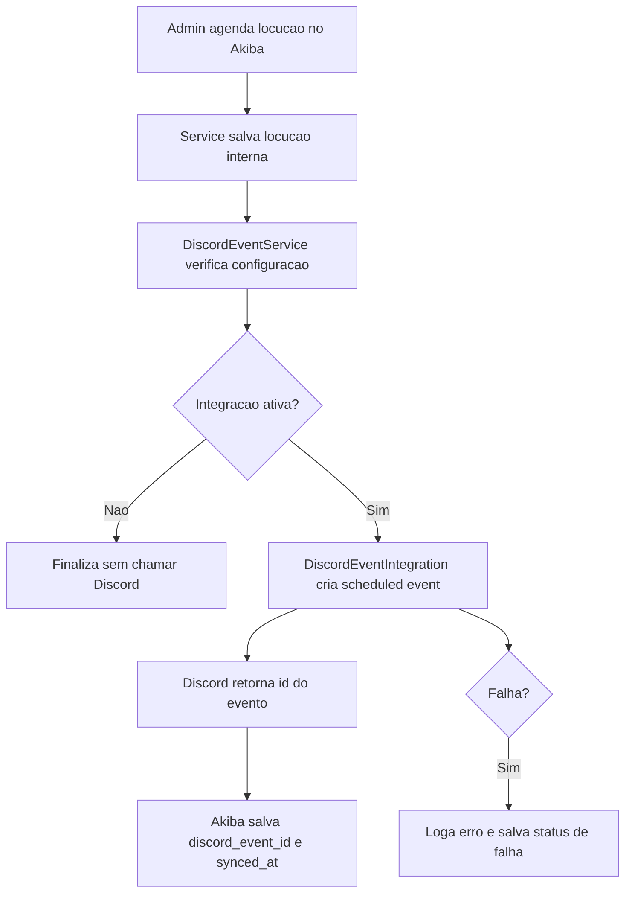

# Plano: eventos de locucao do Akiba no Discord

## Objetivo

Permitir que eventos de locucao criados ou gerenciados no Akiba sejam publicados automaticamente como eventos agendados em um servidor Discord, usando a API oficial de **Guild Scheduled Events**.

O fluxo inicial deve ser simples: o Akiba cria, atualiza ou cancela eventos de locucao no Discord por chamadas HTTP REST usando um bot token. Nao e necessario manter um processo de bot online, Gateway ou WebSocket para essa primeira versao.

A prioridade deste plano e apoiar a operacao de locucao: programacao de transmissoes, sessoes ao vivo, salas de voz/stage, horarios dos locutores e divulgacao automatica para a comunidade.

## Resultado esperado

Quando uma locucao/evento de locucao for criado ou publicado no Akiba:

- o sistema cria um evento agendado no Discord;
- o Akiba salva o ID do evento retornado pelo Discord;
- edicoes relevantes no Akiba podem atualizar o evento no Discord;
- cancelamentos/remocoes no Akiba podem cancelar ou remover o evento no Discord;
- falhas da API do Discord nao quebram o fluxo principal do Akiba;
- a integracao pode ser ligada/desligada por configuracao.

## Decisao tecnica

Usar a REST API do Discord com um bot instalado no servidor.

Para locucao, a recomendacao inicial e criar eventos vinculados a um canal de voz ou stage do Discord, porque isso deixa claro para a comunidade onde a transmissao ou encontro vai acontecer. Evento externo tambem pode existir, mas deve ser tratado como caso secundario quando a locucao acontecer fora do Discord.

Documentacao-base:

- Discord API: Guild Scheduled Event
- Discord API: Permissions
- Discord Support: Scheduled Events

Pontos importantes:

- o bot precisa existir no Discord Developer Portal;
- o bot precisa estar instalado no servidor Discord;
- o token fica apenas no backend, em variavel de ambiente;
- o bot nao precisa aparecer online;
- para criar eventos, o bot precisa de permissao adequada, como `Create Events` e/ou `Manage Events`, dependendo do fluxo;
- para eventos de locucao em canal de voz ou stage, tambem podem ser necessarias permissoes do canal, como visualizar/conectar/falar;
- se a equipe usar canais diferentes por programa, locutor ou quadro, o Akiba deve conseguir escolher o canal do evento.

## Configuracao no Discord

1. Acessar o Discord Developer Portal.
2. Criar uma aplicacao para a Akiba.
3. Criar um bot dentro dessa aplicacao.
4. Copiar o token do bot.
5. Gerar uma URL OAuth2 de instalacao com escopos/permissoes necessarias.
6. Instalar o bot no servidor Discord da Akiba.
7. Garantir que o bot tenha permissao para criar e gerenciar eventos.

Configuracoes esperadas no `.env`:

```env
DISCORD_EVENTS_ENABLED=false
DISCORD_BOT_TOKEN=
DISCORD_GUILD_ID=
DISCORD_DEFAULT_CHANNEL_ID=
DISCORD_STAGE_CHANNEL_ID=
```

Observacoes:

- `DISCORD_DEFAULT_CHANNEL_ID` so deve ser obrigatorio se os eventos forem vinculados a um canal de voz/stage.
- `DISCORD_STAGE_CHANNEL_ID` pode ser usado caso a locucao tenha um palco fixo no Discord.
- Para evento externo, o Discord usa uma localizacao textual em vez de canal.
- `DISCORD_EVENTS_ENABLED` deve iniciar como `false` para evitar publicacoes acidentais.

## Configuracao no Laravel

Adicionar as configuracoes em `config/services.php`, seguindo a regra do projeto de nao usar `env()` diretamente fora de arquivos de config:

```php
'discord' => [
    'events_enabled' => env('DISCORD_EVENTS_ENABLED', false),
    'bot_token' => env('DISCORD_BOT_TOKEN'),
    'guild_id' => env('DISCORD_GUILD_ID'),
    'default_channel_id' => env('DISCORD_DEFAULT_CHANNEL_ID'),
    'stage_channel_id' => env('DISCORD_STAGE_CHANNEL_ID'),
],
```

## Arquitetura proposta

Criar uma integracao para chamadas externas e um service para regras de negocio.

```txt
app/Integrations/DiscordEventIntegration.php
app/Services/DiscordEventService.php
```

### `DiscordEventIntegration`

Responsabilidades:

- montar headers da API do Discord;
- chamar endpoints de eventos agendados;
- aplicar timeout;
- tratar erros HTTP;
- retornar arrays simples para o service;
- logar falhas sem expor o token.

Endpoints principais:

```http
GET /guilds/{guild.id}/scheduled-events
POST /guilds/{guild.id}/scheduled-events
GET /guilds/{guild.id}/scheduled-events/{guild_scheduled_event.id}
PATCH /guilds/{guild.id}/scheduled-events/{guild_scheduled_event.id}
DELETE /guilds/{guild.id}/scheduled-events/{guild_scheduled_event.id}
GET /guilds/{guild.id}/scheduled-events/{guild_scheduled_event.id}/users
```

Base URL:

```txt
https://discord.com/api/v10
```

Header:

```http
Authorization: Bot {DISCORD_BOT_TOKEN}
Content-Type: application/json
```

### `DiscordEventService`

Responsabilidades:

- decidir se a integracao esta ativa;
- transformar um evento interno do Akiba no payload esperado pelo Discord;
- criar evento no Discord;
- atualizar evento existente;
- cancelar/remover evento no Discord;
- persistir o `discord_event_id`;
- evitar duplicidade;
- centralizar logs de sucesso/falha com contexto de dominio.

Metodos esperados:

```php
public function publishEvent(Event $event): ?array
public function updatePublishedEvent(Event $event): ?array
public function deletePublishedEvent(Event $event): void
public function syncEvent(Event $event): ?array
```

O nome real do model deve seguir o que ja existir no Akiba. Se o projeto ainda nao tiver um model de eventos dedicado, essa etapa deve ser adaptada ao modulo atual que representa eventos.

## Dados necessarios no Akiba

O Akiba precisa guardar a relacao entre a locucao/evento interno e o evento do Discord.

Se existir uma tabela de eventos ou agenda de locucao, adicionar campos como:

```txt
discord_event_id nullable string
discord_event_synced_at nullable timestamp
discord_event_sync_status nullable string
discord_event_sync_error nullable text
discord_channel_id nullable string
```

Alternativa mais flexivel:

```txt
event_integrations
```

Campos possiveis:

```txt
id
event_id
provider
provider_event_id
status
last_synced_at
last_error
created_at
updated_at
```

Recomendacao inicial: se a Akiba tera somente Discord no curto prazo, campos diretos na tabela de eventos/locucoes sao suficientes. Se a ideia for integrar Facebook, Google Calendar, Discord e outras plataformas, criar uma tabela de integracoes e melhor.

## Dados especificos para locucao

Para o caso de locucao, o Akiba deve conseguir montar um evento com informacoes operacionais e de divulgacao.

Campos uteis:

```txt
titulo da locucao/programa
descricao curta
locutor ou equipe responsavel
data e hora de inicio
data e hora de fim
timezone
canal Discord onde vai acontecer
status: rascunho, agendado, ao vivo, encerrado, cancelado
link publico no Akiba, se existir
imagem/capa, se existir
```

Regras sugeridas:

- nao criar evento no Discord enquanto a locucao estiver em rascunho;
- criar evento quando a locucao for marcada como agendada/publicada;
- atualizar o Discord quando mudar titulo, descricao, horario ou canal;
- cancelar/remover no Discord quando a locucao for cancelada no Akiba;
- impedir horario de fim menor ou igual ao horario de inicio;
- manter datas em UTC no payload enviado para o Discord.

## Payload para criar evento

O payload depende do tipo de evento.

### Evento em canal de voz ou stage

Este deve ser o padrao para locucao quando a atividade acontecer dentro do Discord.

```json
{
  "name": "Locucao Akiba: Nome do programa",
  "description": "Com Locutor X. Entre no canal no horario marcado.",
  "scheduled_start_time": "2026-10-20T22:00:00Z",
  "scheduled_end_time": "2026-10-20T23:00:00Z",
  "privacy_level": 2,
  "entity_type": 2,
  "channel_id": "DISCORD_CHANNEL_ID"
}
```

Para Stage, o `entity_type` deve ser `1`. Para canal de voz, deve ser `2`.

### Evento externo

Use quando a locucao acontece fora de um canal do Discord, por exemplo uma transmissao em player proprio, YouTube, Twitch ou outra pagina da Akiba.

```json
{
  "name": "Locucao Akiba: Nome do programa",
  "description": "Com Locutor X. Acompanhe pelo link da Akiba.",
  "scheduled_start_time": "2026-10-20T22:00:00Z",
  "scheduled_end_time": "2026-10-20T23:00:00Z",
  "privacy_level": 2,
  "entity_type": 3,
  "entity_metadata": {
    "location": "https://akiba.com.br/locucao/slug"
  }
}
```

Valores relevantes:

```txt
privacy_level: 2 = Guild Only
entity_type: 1 = Stage Instance
entity_type: 2 = Voice
entity_type: 3 = External
```

## Fluxo inicial recomendado



## Fases de implementacao

### Fase 1: configuracao e cliente HTTP

- adicionar variaveis no `.env.example`;
- adicionar bloco `discord` em `config/services.php`;
- criar `DiscordEventIntegration`;
- implementar metodos `create`, `update`, `delete`, `list` e `users`;
- adicionar testes com `Http::fake()`.

### Fase 2: persistencia do vinculo

- identificar o model/tabela de locucao ou eventos do Akiba;
- criar migration para salvar `discord_event_id` e status de sync, ou criar tabela generica de integracoes;
- ajustar model/fillable/casts se necessario.

### Fase 3: service de dominio

- criar `DiscordEventService`;
- montar payload a partir do evento interno;
- validar datas e timezone;
- impedir duplicidade quando ja existir `discord_event_id`;
- salvar status de sucesso/falha.

### Fase 4: acoplamento no fluxo de eventos

- chamar `DiscordEventService` no ponto onde a locucao/evento do Akiba e agendado ou publicado;
- idealmente usar job/queue para nao travar a tela do admin;
- manter falhas do Discord isoladas do fluxo principal.

### Fase 5: interface administrativa

- exibir status da sincronizacao com Discord;
- adicionar acao manual "Publicar no Discord" ou "Sincronizar novamente";
- permitir configurar se aquela locucao deve ou nao ir para o Discord;
- permitir escolher canal de voz/stage quando houver mais de um;
- mostrar link do evento no Discord quando existir.

### Fase 6: melhorias opcionais

- upload de imagem de capa do evento, se o endpoint e permissao suportarem no fluxo escolhido;
- listar usuarios interessados no evento;
- importar eventos existentes do Discord;
- sincronizar alteracoes feitas diretamente no Discord;
- usar Gateway/WebSocket para eventos em tempo real.

## O que nao entra na primeira versao

- manter bot online;
- comandos slash;
- leitura de mensagens;
- Gateway/WebSocket;
- sincronizacao bidirecional em tempo real;
- painel complexo de configuracao por servidor.

Esses pontos so devem entrar se o produto realmente precisar de interacao em tempo real ou comandos dentro do Discord.

## Tratamento de erros

Erros esperados:

- token ausente;
- bot sem permissao;
- bot nao instalado no servidor;
- `guild_id` errado;
- `channel_id` invalido;
- data no passado;
- payload invalido;
- rate limit da API do Discord;
- indisponibilidade temporaria da API.

Comportamento recomendado:

- registrar logs com `event_id`, `discord_event_id`, status HTTP e mensagem resumida;
- nunca logar o token;
- salvar status de falha no evento;
- permitir retry manual pelo painel;
- para chamadas automaticas, considerar job com retry/backoff.

## Testes recomendados

### Testes unitarios/integracao Laravel

- cria evento no Discord quando integracao esta ativa;
- nao chama Discord quando `DISCORD_EVENTS_ENABLED=false`;
- nao duplica evento se `discord_event_id` ja existir;
- atualiza evento existente com `PATCH`;
- remove evento existente com `DELETE`;
- salva erro quando API retorna 403;
- usa timezone correto ao montar `scheduled_start_time`;
- nao expoe token em logs ou mensagens persistidas.

### Teste manual

1. Criar aplicacao/bot no Discord.
2. Instalar bot em um servidor de teste.
3. Configurar `.env` local.
4. Configurar um canal de voz/stage de teste.
5. Criar uma locucao agendada no Akiba.
6. Confirmar que o evento aparece no Discord no canal correto.
7. Editar titulo/data/canal no Akiba.
8. Confirmar atualizacao no Discord.
9. Cancelar/remover a locucao no Akiba.
10. Confirmar remocao/cancelamento no Discord.

## Ordem pratica de execucao

1. Confirmar onde os eventos vivem hoje no Akiba: model, tabela, controller e service.
2. Criar configuracao e integracao HTTP isolada.
3. Criar persistencia do ID externo.
4. Criar service de dominio.
5. Ligar o service ao fluxo de publicacao/edicao/cancelamento.
6. Criar testes com `Http::fake()`.
7. Testar manualmente em um servidor Discord de teste.

## Observacoes finais

A primeira versao deve tratar o Discord como destino de publicacao, nao como origem da verdade. O Akiba continua sendo o lugar principal onde a locucao e criada, editada e cancelada.

Se futuramente for necessario refletir no Akiba o que foi alterado diretamente no Discord, ai sim vale criar uma segunda etapa com Gateway/WebSocket ou um job periodico de reconciliacao.
