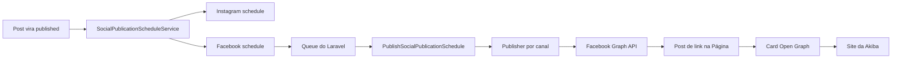

# Plano: publicação de posts na Página do Facebook

## Objetivo geral

Permitir que a Rede Akiba publique automaticamente matérias, reviews e eventos em sua Página oficial do Facebook, usando a infraestrutura social já existente e priorizando tráfego qualificado para o site.

O fluxo final deve:

1. reutilizar o texto social salvo em `posts.social`;
2. criar uma publicação de link clicável para a URL canônica do conteúdo;
3. apresentar título, descrição e imagem corretos no card do Facebook;
4. executar a chamada à Meta pela queue do Laravel;
5. registrar o resultado em `social_publication_schedules`;
6. tratar Facebook e Instagram como destinos independentes;
7. nunca impedir a publicação do conteúdo no site quando o Facebook estiver indisponível.

O trabalho está dividido em capítulos. Cada etapa é uma entrega pequena, testável e adequada para uma sessão isolada. Uma etapa só deve começar depois que os critérios de conclusão da anterior estiverem atendidos.

## Decisões de escopo

- O destino é uma **Página do Facebook** administrada pela Rede Akiba. Perfis pessoais e grupos não fazem parte deste plano.
- A primeira versão publica somente no Feed da Página.
- O formato principal será um **post de link**, enviado para `/{page-id}/feed` com `message` e `link`.
- A URL canônica da Akiba será o destino clicável e a fonte do preview Open Graph.
- Publicação de foto isolada em `/{page-id}/photos` não será o padrão inicial, porque o clique na imagem prioriza a visualização da foto em vez da navegação ao site.
- Reels, vídeos, Stories, anúncios, impulsionamento, comentários, mensagens e Insights ficam fora da primeira versão.
- A queue do Laravel continua responsável por tentativas, reserva, backoff e falhas técnicas.
- `social_publication_schedules` continua sendo a fonte do estado de negócio da divulgação.
- A integração deve permanecer desligada por padrão até a homologação real.

## Regras do fluxo

- Enviar um conteúdo para revisão apenas salva a proposta social; não publica no Facebook.
- A publicação social só é criada quando o conteúdo efetivamente passa para `published` pela primeira vez.
- Atualizar um post já publicado não deve reenviá-lo automaticamente.
- Instagram e Facebook devem gerar agendamentos separados e podem terminar com estados diferentes.
- Falha no Facebook não pode cancelar nem reverter o post local ou a publicação no Instagram.
- O payload persistido deve preservar a mensagem e a URL exatas entregues ao job.
- Tokens nunca devem aparecer em logs, banco, respostas HTTP, payloads de jobs ou mensagens de erro.
- O token do Instagram Login não deve ser presumido como válido para a Página do Facebook.
- A Página precisa ser retornada pela Meta com a tarefa `CREATE_CONTENT` para a identidade autenticada.
- Erros definitivos de autenticação, permissão ou validação devem encerrar somente o agendamento do Facebook.
- Limite de API e indisponibilidade temporária devem usar o backoff da queue.
- A publicação inicial deve usar conteúdo claramente identificado como teste e ser removida manualmente após a homologação, se necessário.

## Estratégia para gerar tráfego

O Facebook deve publicar a URL da matéria como link, permitindo que a plataforma construa um card clicável a partir dos metadados Open Graph da página.

```text
Usuário vê a publicação no Facebook
                  ↓
         toca no card do link
                  ↓
       abre a URL canônica da Akiba
                  ↓
        parâmetros UTM identificam
        a origem da visita
```

Formato inicial da URL:

```text
https://akiba.com.br/{rota-do-conteudo}
    ?utm_source=facebook
    &utm_medium=social
    &utm_campaign=organic_post
```

Os parâmetros de campanha servem para atribuição. A tag `og:url` deve continuar apontando para a URL canônica limpa, sem UTM.

## Arquitetura-alvo



Responsabilidades previstas:

- `app/Services`: decidir destinos, montar snapshots e criar agendamentos;
- `app/Integrations/MetaSocial`: autenticar, publicar e normalizar respostas da Graph API;
- `app/Jobs`: consumir um agendamento sem conhecer detalhes de cada canal;
- `app/Models/SocialPublicationSchedule`: preservar estado e resultado por canal;
- controllers e resources públicos: fornecer metadados Open Graph corretos;
- `resources/js/lib/components/shared/Meta.svelte`: renderizar metadados sociais recebidos do backend;
- `tests`: representar os contratos externos com HTTP fake e validar a orquestração local.

---

# Capítulo 1 — Acesso oficial à Página e contrato da integração

**Acompanhamento do capítulo**

- [ ] Executado
- **Observações:** Pesquisa técnica revisada em 26/10/2026. A publicação em Página usa `graph.facebook.com`, Page Access Token, a tarefa `CREATE_CONTENT` e as permissões `pages_show_list`, `pages_read_engagement` e `pages_manage_posts`. Os requisitos devem ser reconfirmados na versão da Graph API configurada durante a implementação.

## Objetivo do capítulo

Confirmar que a aplicação e a identidade administrativa conseguem atuar sobre a Página oficial, definir o contrato do canal Facebook e preparar a configuração sem publicar conteúdo real ainda.

## Etapa 1 — Confirmar propriedade e acesso à Página

**Acompanhamento da etapa**

- [ ] Executada
- **Observações:** —

Tarefas:

- [ ] Identificar o ID oficial da Página da Rede Akiba.
- [ ] Confirmar que a Página pertence ao portfólio empresarial esperado.
- [ ] Confirmar qual conta ou System User será responsável pela integração.
- [ ] Consultar `/{user-id}/accounts` com `fields=id,name,access_token,tasks`.
- [ ] Confirmar que a Página retornada contém a tarefa `CREATE_CONTENT`.
- [ ] Registrar somente IDs e nomes durante a verificação; nunca registrar o token.
- [ ] Decidir e documentar como o Page Access Token será renovado ou substituído quando perder validade.

Critério de conclusão: o ID correto da Página, a identidade responsável e a capacidade `CREATE_CONTENT` estão confirmados sem tentativa de publicação.

## Etapa 2 — Preparar permissões e revisão do aplicativo Meta

**Acompanhamento da etapa**

- [ ] Executada
- **Observações:** —

Tarefas:

- [ ] Confirmar o tipo e o modo do aplicativo Meta usado pela Akiba.
- [ ] Solicitar ou validar `pages_show_list`.
- [ ] Solicitar ou validar `pages_read_engagement`.
- [ ] Solicitar ou validar `pages_manage_posts`.
- [ ] Verificar se a Página e os usuários de homologação podem operar enquanto o app estiver em modo de desenvolvimento.
- [ ] Preparar evidências e instruções para App Review caso o uso em produção exija acesso avançado.
- [ ] Não solicitar permissões de anúncios, comentários, mensagens ou Insights nesta fase.

Critério de conclusão: o aplicativo possui somente as permissões necessárias para listar e publicar na Página dentro do ambiente previsto.

## Etapa 3 — Adicionar configuração segura no Laravel

**Acompanhamento da etapa**

- [ ] Executada
- **Observações:** —

Configuração prevista:

```env
META_FACEBOOK_PAGE_ID=
META_FACEBOOK_PAGE_ACCESS_TOKEN=
META_FACEBOOK_ENABLED=false
```

Tarefas:

- [ ] Adicionar as variáveis sem valores reais em `.env.example`.
- [ ] Mapear os valores em `config/services.php`.
- [ ] Reutilizar `META_GRAPH_VERSION` somente se a versão for compatível com os dois canais.
- [ ] Manter tokens separados para Instagram e Facebook.
- [ ] Validar ID e token ausentes sem incluir valores sensíveis na exceção.
- [ ] Manter `META_FACEBOOK_ENABLED=false` por padrão.
- [ ] Cobrir a configuração com testes unitários.

Critério de conclusão: o Laravel consegue informar localmente se o Facebook está habilitado e configurado, sem realizar chamada externa.

## Etapa 4 — Estender o contrato de canais

**Acompanhamento da etapa**

- [ ] Executada
- **Observações:** —

Tarefas:

- [ ] Adicionar `Facebook` a `PublicationChannel`.
- [ ] Manter `feed` como o único posicionamento inicial do canal.
- [ ] Tornar os dados de mídia opcionais no contrato comum, pois o post de link não exige upload da arte social.
- [ ] Garantir que `caption`, `postUrl`, `idempotencyKey` e canal sejam suficientes para o Facebook.
- [ ] Definir o retorno normalizado com ID externo e data de publicação.
- [ ] Definir o permalink como opcional até confirmar um campo confiável na resposta ou consulta posterior.
- [ ] Manter o contrato aberto para futuros publishers que não pertençam à Meta.

Critério de conclusão: os contratos representam Instagram com mídia e Facebook com link sem campos fictícios ou valores vazios obrigatórios.

---

# Capítulo 2 — Cliente da Pages API e publicação de link

**Acompanhamento do capítulo**

- [ ] Executado
- **Observações:** —

## Objetivo do capítulo

Implementar e testar a publicação de uma mensagem com link na Página, sem ainda conectar o canal ao fluxo automático dos posts reais.

## Etapa 1 — Registrar fixtures do contrato externo

**Acompanhamento da etapa**

- [ ] Executada
- **Observações:** —

Tarefas:

- [ ] Criar fixture de listagem de Páginas com `id`, `name`, `tasks` e token mascarado ou fictício.
- [ ] Criar fixture de publicação bem-sucedida em `/{page-id}/feed`.
- [ ] Criar fixture de token inválido.
- [ ] Criar fixture de permissão ausente, incluindo erro `#200` quando aplicável.
- [ ] Criar fixture de parâmetro ou URL inválida.
- [ ] Criar fixture de limite de API e erro temporário.
- [ ] Garantir que nenhum teste dependa da internet ou de credencial real.

Critério de conclusão: os cenários externos necessários estão representados por respostas locais estáveis.

## Etapa 2 — Separar transporte e credenciais por canal

**Acompanhamento da etapa**

- [ ] Executada
- **Observações:** —

Tarefas:

- [ ] Evitar que o request builder de `graph.instagram.com` seja reutilizado incorretamente para a Página.
- [ ] Criar request autenticado para `graph.facebook.com/{version}`.
- [ ] Usar exclusivamente o Page Access Token nesse transporte.
- [ ] Reutilizar timeout e connect timeout já configurados.
- [ ] Preservar a interface `Publisher` usada pelo job.
- [ ] Encaminhar cada `PublicationChannel` ao publicador correto sem adicionar condicionais ao job.
- [ ] Nunca incluir token na URL registrada, no contexto do log ou em exceções.

Critério de conclusão: Instagram e Facebook possuem hosts, tokens e payloads independentes atrás do mesmo contrato de publicação.

## Etapa 3 — Implementar publicação no Feed da Página

**Acompanhamento da etapa**

- [ ] Executada
- **Observações:** —

Requisição prevista:

```text
POST https://graph.facebook.com/{version}/{page-id}/feed

message={texto social}
link={url da Akiba com UTM}
```

Tarefas:

- [ ] Enviar `message` e `link` como formulário ou corpo aceito pela Graph API.
- [ ] Usar a URL absoluta e publicamente acessível da Akiba.
- [ ] Não duplicar a URL visível no fim da mensagem sem necessidade editorial.
- [ ] Validar a presença do ID na resposta.
- [ ] Normalizar o ID como `external_id` do agendamento.
- [ ] Preservar o mesmo payload em todas as tentativas do mesmo agendamento.
- [ ] Não implementar `/photos`, vídeo ou agendamento nativo do Facebook nesta etapa.

Critério de conclusão: um HTTP fake demonstra a requisição exata e o resultado normalizado de uma publicação de link.

## Etapa 4 — Classificar erros e retries

**Acompanhamento da etapa**

- [ ] Executada
- **Observações:** —

Tarefas:

- [ ] Reutilizar a classificação comum somente quando os códigos tiverem o mesmo significado nos dois canais.
- [ ] Tratar autenticação, permissão e validação como falhas definitivas.
- [ ] Tratar indisponibilidade, timeout e limite de API como recuperáveis.
- [ ] Salvar somente mensagem sanitizada em `last_error`.
- [ ] Manter detalhes técnicos completos apenas nos logs seguros do Laravel.
- [ ] Confirmar que uma falha do Facebook não altera o agendamento do Instagram.

Critério de conclusão: testes cobrem sucesso, falha definitiva, retry e esgotamento das tentativas sem expor credenciais.

## Etapa 5 — Homologar uma publicação isolada

**Acompanhamento da etapa**

- [ ] Executada
- **Observações:** —

Tarefas:

- [ ] Usar uma página de teste ou um conteúdo inequivocamente identificado como homologação.
- [ ] Publicar uma mensagem curta com link para uma URL pública controlada pela Akiba.
- [ ] Conferir autoria da Página, texto, link, imagem do preview e ID retornado.
- [ ] Confirmar que o clique abre a URL esperada.
- [ ] Remover manualmente a publicação de teste caso ela não deva permanecer pública.
- [ ] Desligar `META_FACEBOOK_ENABLED` após a homologação inicial.

Critério de conclusão: a Página recebe uma publicação real, clicável e rastreável, usando somente a API oficial.

---

# Capítulo 3 — Preview Open Graph e rastreamento de tráfego

**Acompanhamento do capítulo**

- [ ] Executado
- **Observações:** O card de uma publicação de link é controlado pelos metadados da URL, não pela arte enviada ao Instagram. Este capítulo é obrigatório antes de automatizar o Facebook.

## Objetivo do capítulo

Garantir que o crawler do Facebook obtenha título, descrição, imagem e URL canônica corretos e que os acessos provenientes das publicações possam ser medidos.

## Etapa 1 — Auditar os metadados públicos atuais

**Acompanhamento da etapa**

- [ ] Executada
- **Observações:** —

Tarefas:

- [ ] Inspecionar a resposta HTML inicial de matéria, review e evento sem executar JavaScript.
- [ ] Confirmar se `@inertiaHead` entrega os metadados dinâmicos ao crawler.
- [ ] Verificar `og:title`, `og:description`, `og:type`, `og:url` e `og:image`.
- [ ] Verificar se `og:image` usa URL absoluta em HTTPS.
- [ ] Confirmar que conteúdos publicados retornam HTTP 200 para o crawler.
- [ ] Confirmar que autenticação, robots ou middleware não bloqueiam o crawler da Meta.
- [ ] Registrar as lacunas encontradas antes de modificar o frontend.

Critério de conclusão: existe evidência do HTML que o crawler recebe em cada tipo de conteúdo.

## Etapa 2 — Entregar Open Graph dinâmico no HTML inicial

**Acompanhamento da etapa**

- [ ] Executada
- **Observações:** —

Tarefas:

- [ ] Passar título, resumo, URL canônica e imagem pelos controllers/resources públicos.
- [ ] Atualizar `Meta.svelte` para consumir os campos reais do conteúdo.
- [ ] Se o crawler não receber os dados sem JavaScript, renderizar as tags necessárias pelo backend ou habilitar a estratégia SSR já compatível com o projeto.
- [ ] Usar descrição curta derivada de conteúdo limpo, sem HTML ou blocos editoriais extensos.
- [ ] Definir `og:type=article` para matérias e reviews quando apropriado.
- [ ] Adicionar dimensões e MIME da imagem quando disponíveis.
- [ ] Manter canonical sem parâmetros UTM.

Critério de conclusão: o HTML inicial contém metadados distintos e corretos para cada conteúdo publicado.

## Etapa 3 — Definir imagem estável para o card

**Acompanhamento da etapa**

- [ ] Executada
- **Observações:** —

Tarefas:

- [ ] Adotar proporção Open Graph `1200x630` como referência.
- [ ] Avaliar o reaproveitamento visual do modelo `discord-post` sem acoplar o arquivo temporário do Discord.
- [ ] Criar, se necessário, um modelo estável `open-graph-post` no `SocialArtworkProcess`.
- [ ] Armazenar a imagem de preview em caminho durável ligado ao post, não ao job social temporário.
- [ ] Não remover a imagem depois que o Facebook publicar, pois o crawler pode consultá-la novamente.
- [ ] Usar a capa original como fallback quando a composição não puder ser gerada.
- [ ] Validar JPEG, dimensões, tamanho, contraste e leitura em miniatura.

Critério de conclusão: cada conteúdo possui uma `og:image` estável, pública e adequada ao card do Facebook.

## Etapa 4 — Validar o card com as ferramentas da Meta

**Acompanhamento da etapa**

- [ ] Executada
- **Observações:** —

Tarefas:

- [ ] Testar matéria, review e evento no Sharing Debugger.
- [ ] Solicitar novo scrape depois de alterar metadados ou imagem.
- [ ] Conferir título, descrição, imagem, URL final e ausência de redirecionamento inesperado.
- [ ] Testar uma URL com UTM e confirmar que `og:url` continua canônica.
- [ ] Registrar capturas ou resultados da homologação para comparação futura.

Critério de conclusão: o Sharing Debugger apresenta o mesmo card esperado para os três módulos.

## Etapa 5 — Adicionar atribuição de tráfego

**Acompanhamento da etapa**

- [ ] Executada
- **Observações:** —

Tarefas:

- [ ] Criar um builder central de URL social com parâmetros UTM.
- [ ] Usar `utm_source=facebook`.
- [ ] Usar `utm_medium=social`.
- [ ] Usar `utm_campaign=organic_post` na primeira versão.
- [ ] Avaliar `utm_content` por módulo ou versão sem incluir dados pessoais.
- [ ] Testar preservação dos parâmetros até a aplicação ou ferramenta analítica.
- [ ] Evitar criar URLs canônicas diferentes por campanha.

Critério de conclusão: um acesso originado na publicação pode ser identificado como Facebook orgânico sem fragmentar a canonicalização.

---

# Capítulo 4 — Orquestração multicanal e painel

**Acompanhamento do capítulo**

- [ ] Executado
- **Observações:** —

## Objetivo do capítulo

Conectar o Facebook ao fluxo real de publicação, reaproveitando `social_publication_schedules`, a queue e o formulário social existente.

## Etapa 1 — Adaptar o payload social do post

**Acompanhamento da etapa**

- [ ] Executada
- **Observações:** —

Contrato esperado:

```json
{
  "social": {
    "text": "Texto editorial compartilhado pelos canais.",
    "hashtags": ["anime", "redeakiba"],
    "channels": {
      "instagram": true,
      "facebook": true
    }
  }
}
```

Tarefas:

- [ ] Adicionar `social.channels.facebook` à normalização do backend.
- [ ] Atualizar validações de criação, revisão, aprovação e publicação.
- [ ] Preservar compatibilidade com posts antigos sem a chave `facebook`.
- [ ] Definir se o Facebook será obrigatório quando globalmente habilitado ou selecionável no modal.
- [ ] Recomenda-se habilitação automática global na primeira versão, evitando mais uma decisão editorial por post.
- [ ] Atualizar o modal somente se houver valor real em permitir desligar um canal por publicação.
- [ ] Não criar campos duplicados de texto apenas para o Facebook nesta fase.

Critério de conclusão: o mesmo conteúdo social consegue declarar Instagram e Facebook sem quebrar rascunhos ou registros antigos.

## Etapa 2 — Criar um agendamento por canal

**Acompanhamento da etapa**

- [ ] Executada
- **Observações:** —

Tarefas:

- [ ] Fazer `SocialPublicationScheduleService` incluir Facebook entre os canais habilitados.
- [ ] Criar uma linha `facebook/feed` independente da linha `instagram/feed`.
- [ ] Persistir no `payload` a mensagem e a URL com UTM.
- [ ] Permitir `media_path` e `media_url` nulos para publicações que dependem do card Open Graph.
- [ ] Não gerar a arte do Instagram para o Facebook.
- [ ] Impedir que falha de geração da arte do Instagram bloqueie a criação do agendamento do Facebook.
- [ ] Gerar chave de idempotência única por origem, versão, canal e posicionamento.

Critério de conclusão: um post publicado cria agendamentos independentes para os canais habilitados, com snapshots adequados a cada destino.

## Etapa 3 — Reutilizar o job e a política de retry

**Acompanhamento da etapa**

- [ ] Executada
- **Observações:** —

Tarefas:

- [ ] Manter `PublishSocialPublicationSchedule` genérico.
- [ ] Fazer o job construir o contrato sem exigir mídia quando o canal for Facebook.
- [ ] Manter idempotência local por `idempotency_key` e status `published`.
- [ ] Manter retries e backoff na queue do Laravel.
- [ ] Fazer `social-publications:dispatch-pending` recuperar também agendamentos do Facebook.
- [ ] Não duplicar a mecânica da queue em `social_publication_schedules`.
- [ ] Confirmar que agendamento `failed` não é redisparado automaticamente.

Critério de conclusão: o mesmo job processa Instagram e Facebook, mas cada publisher recebe apenas os dados necessários ao seu canal.

## Etapa 4 — Expor estado operacional mínimo no painel

**Acompanhamento da etapa**

- [ ] Executada
- **Observações:** —

Tarefas:

- [ ] Avaliar onde o painel deve mostrar o estado das publicações sociais.
- [ ] Exibir canal, posicionamento, status, data e erro resumido.
- [ ] Exibir link externo somente quando um permalink confiável estiver disponível.
- [ ] Não exibir token, payload técnico ou resposta completa da Meta.
- [ ] Preparar ação de tentar novamente somente para administradores e registros `failed`.
- [ ] Ao tentar novamente, reutilizar o mesmo snapshot e limpar `last_error` de forma controlada.
- [ ] Aplicar `orange-citric` às ações clicáveis conforme o padrão visual do projeto.

Critério de conclusão: um administrador consegue distinguir sucesso e falha por canal sem consultar diretamente o banco.

---

# Capítulo 5 — Testes, homologação e operação

**Acompanhamento do capítulo**

- [ ] Executado
- **Observações:** —

## Objetivo do capítulo

Validar o fluxo completo, ativar o Facebook com segurança e documentar a manutenção das credenciais e da integração.

## Etapa 1 — Cobrir contratos e integração local

**Acompanhamento da etapa**

- [ ] Executada
- **Observações:** —

Tarefas:

- [ ] Testar configuração habilitada, desabilitada e incompleta.
- [ ] Testar requisição `message + link` com HTTP fake.
- [ ] Testar ID externo ausente ou inválido.
- [ ] Testar erros de autenticação, permissão, validação, limite e indisponibilidade.
- [ ] Testar que o token nunca aparece em exceções ou logs.
- [ ] Testar que o Instagram continua usando seu host e token atuais.

Critério de conclusão: os contratos do Facebook estão cobertos sem chamada externa e sem regressão no Instagram.

## Etapa 2 — Cobrir orquestração multicanal

**Acompanhamento da etapa**

- [ ] Executada
- **Observações:** —

Tarefas:

- [ ] Testar criação de duas linhas quando Instagram e Facebook estiverem habilitados.
- [ ] Testar somente Instagram e somente Facebook.
- [ ] Testar ambos desabilitados.
- [ ] Testar aprovação manual e publicação agendada de conteúdo.
- [ ] Testar que atualização de conteúdo já publicado não reenfileira.
- [ ] Testar sucesso em um canal e falha no outro.
- [ ] Testar recuperação de agendamento pendente.
- [ ] Testar bloqueio de duplicidade pelo `idempotency_key`.

Critério de conclusão: os canais evoluem independentemente e nenhum cenário duplica a publicação localmente.

## Etapa 3 — Validar Open Graph e URLs

**Acompanhamento da etapa**

- [ ] Executada
- **Observações:** —

Tarefas:

- [ ] Testar metadados de matéria, review e evento.
- [ ] Testar título e descrição com caracteres especiais e conteúdo longo.
- [ ] Testar imagem ausente e fallback.
- [ ] Testar URL absoluta, canonical e parâmetros UTM.
- [ ] Testar a resposta sem depender da execução de JavaScript quando necessário ao crawler.
- [ ] Confirmar que a imagem estável não é apagada pelo job.

Critério de conclusão: testes automatizados e o Sharing Debugger concordam sobre os metadados publicados.

## Etapa 4 — Homologar o fluxo completo

**Acompanhamento da etapa**

- [ ] Executada
- **Observações:** —

Tarefas:

- [ ] Ativar o Facebook apenas no ambiente de homologação.
- [ ] Publicar um conteúdo identificável como teste pelo fluxo real do painel.
- [ ] Confirmar a linha `facebook/feed` em `social_publication_schedules`.
- [ ] Processar o job pela queue normal.
- [ ] Conferir texto, card, link, UTM, autoria e ID externo.
- [ ] Reexecutar o job publicado e confirmar que não duplica localmente.
- [ ] Simular falha do Facebook e confirmar que site e Instagram permanecem intactos.
- [ ] Registrar o resultado e desligar a chave até o aceite final.

Critério de conclusão: o fluxo real publica uma única vez na Página e direciona corretamente ao site.

## Etapa 5 — Preparar ativação e manutenção

**Acompanhamento da etapa**

- [ ] Executada
- **Observações:** —

Tarefas:

- [ ] Documentar onde renovar ou substituir o Page Access Token.
- [ ] Documentar o impacto de remover a identidade responsável ou alterar suas tarefas na Página.
- [ ] Definir alerta para falhas definitivas de autenticação ou permissão.
- [ ] Definir procedimento manual de retry após corrigir credenciais.
- [ ] Confirmar scheduler e worker ativos em produção.
- [ ] Ativar `META_FACEBOOK_ENABLED` somente depois do aceite.
- [ ] Acompanhar as primeiras publicações e o tráfego identificado pelos UTMs.
- [ ] Reavaliar texto, imagem e frequência com base nos acessos reais, não apenas em alcance ou curtidas.

Critério de conclusão: a integração está ativada com procedimento de manutenção, observabilidade e reversão documentado.

---

# Fora de escopo nesta primeira versão

- Publicação em perfil pessoal ou grupo.
- Facebook Stories.
- Reels e upload de vídeo.
- Álbuns e múltiplas fotos.
- Agendamento nativo da Meta por `scheduled_publish_time`.
- Campanhas, anúncios ou impulsionamento.
- Moderação de comentários.
- Messenger.
- Métricas e Insights da Página.
- Exclusão ou edição automática de publicações já enviadas.
- Personalização editorial diferente por canal.

Esses itens devem virar capítulos ou planos próprios caso sejam priorizados.

---

# Referências oficiais

Referências verificadas durante a elaboração em 26/10/2026. Os requisitos devem ser reconfirmados na versão da Graph API usada na implementação.

- Pages API — Posts: `https://developers.facebook.com/docs/pages-api/posts/`
- Graph API — Page Feed: `https://developers.facebook.com/docs/graph-api/reference/page/feed/`
- Graph API — Page Photos: `https://developers.facebook.com/docs/graph-api/reference/page/photos/`
- Page Access Tokens: `https://developers.facebook.com/docs/pages-api/getting-started/page-access-tokens/`
- Permissões do Facebook Login: `https://developers.facebook.com/docs/permissions/`
- App Review: `https://developers.facebook.com/docs/app-review/`
- Sharing Debugger: `https://developers.facebook.com/tools/debug/`
- Open Graph: `https://ogp.me/`
