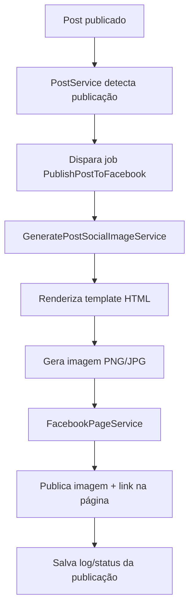

# Plano: publicação automática de posts no Facebook com imagem dinâmica

## Objetivo

Criar um fluxo para publicar posts da Akiba automaticamente em uma página do Facebook quando um conteúdo for publicado no painel. A publicação deve usar os dados do post e uma imagem social gerada dinamicamente a partir de um template HTML personalizado.

A ideia central é separar o processo em três partes:

1. O post é publicado no sistema.
2. O sistema gera uma imagem de divulgação com layout editorial próprio para redes sociais, usando um template HTML da Akiba.
3. Um service publica essa imagem e o link do post na página do Facebook.

Essa imagem não deve ser apenas a capa solta do post. Ela precisa ter composição própria: branding, título, categoria, imagem de apoio, textura/elementos visuais e hierarquia pensada para compartilhamento em redes sociais.

## Estado atual relevante

Hoje já existe um fluxo parcial de divulgação:

- `PostService` chama notificações push e webhook do Discord quando o post muda para `published`.
- `DiscordWebhookService` usa a rota `post.social-image` para montar embed.
- `PostSocialImageController` existe, mas atualmente só retorna a capa/imagem original do post em JPEG.

Arquivos relevantes:

- `app/Services/PostService.php`
- `app/Integrations/DiscordWebhookService.php`
- `app/Http/Controllers/Public/PostSocialImageController.php`
- `routes/web/public.php`

Esse fluxo pode ser reaproveitado, mas a imagem social precisa evoluir de “capa original” para “arte gerada com template”.

## Resultado esperado

Quando uma matéria, review ou evento for publicado:

- o sistema gera uma imagem final no padrão da Akiba;
- a imagem contém dados do post, como título, tag, tipo de conteúdo, capa e branding;
- a imagem segue um layout próprio de social card da Akiba, e não apenas a imagem original do post;
- a imagem fica salva em storage público ou caminho acessível;
- o service do Facebook publica na página configurada;
- a publicação do Facebook contém texto curto, link do post e imagem;
- falhas no Facebook não impedem o post de ser publicado no site;
- o sistema evita publicar o mesmo post duas vezes na página.

## Decisão de arquitetura proposta

Criar um fluxo assíncrono com job/queue. Publicar no Facebook diretamente dentro do `PostService` seria arriscado, porque a API externa pode demorar ou falhar. O ideal é o `PostService` apenas disparar uma intenção de divulgação.

Fluxo proposto:



## Componentes novos

### 1. Template HTML da imagem

Criar um template próprio para a imagem social, por exemplo:

```txt
resources/views/social/post-card.blade.php
```

Esse template deve receber um DTO/array com dados do post:

- título;
- módulo (`post`, `review`, `event`);
- tag principal;
- nome da tag;
- capa/imagem;
- autor, se fizer sentido;
- URL pública;
- logo da Akiba;
- data de publicação.

O HTML deve ser pensado para um tamanho fixo, por exemplo:

```txt
1200x630
```

Esse tamanho funciona bem para Facebook/Open Graph e também deve ser reutilizado no Discord. Quando esse padrão estiver pronto, o Discord deve parar de usar a capa solta e passar a usar o mesmo card social gerado.

### Diretrizes visuais do social card

O layout precisa ser criado como uma peça própria de rede social. Requisitos iniciais:

- canvas fixo 1200x630;
- logo da Rede Akiba em área consistente;
- tag/categoria visível, como `News`, `Reviews`, `Eventos` ou outra tag principal;
- título em destaque com quebra de linha controlada;
- imagem/capa do post como elemento de apoio, não necessariamente ocupando tudo;
- fundo com textura, gradiente ou elementos de marca;
- variação visual por módulo, se fizer sentido;
- boa leitura em miniatura;
- fallback quando o post não tiver capa/imagem;
- evitar excesso de texto.

Estrutura visual sugerida:

```txt
┌────────────────────────────────────────────┐
│ Logo Akiba                   Categoria     │
│                                            │
│ Título principal do post                   │
│ com 2 ou 3 linhas no máximo                │
│                                            │
│ Imagem/capa recortada + textura/elementos  │
│                                            │
│ akiba.com.br / chamada curta               │
└────────────────────────────────────────────┘
```

### 2. Geração da imagem a partir do HTML

Opções possíveis:

#### Opção A: Spatie Browsershot

Usar `spatie/browsershot`, que renderiza HTML usando Chromium/Puppeteer.

Vantagens:

- mais simples para transformar HTML/CSS em imagem;
- permite usar layout moderno com CSS;
- facilita manter visual em Blade/HTML.

Cuidados:

- exige Node/Chromium no ambiente;
- precisa validar dependências no Docker;
- pode ser mais pesado.

#### Opção B: Playwright via Node

Criar um script Node que recebe uma URL/template e tira screenshot.

Vantagens:

- controle direto com Playwright;
- já conversa bem com frontend moderno.

Cuidados:

- mais integração manual com Laravel;
- precisa gerenciar chamada PHP → Node;
- também exige browser headless no ambiente.

#### Opção C: Intervention Image

Gerar tudo via PHP usando `intervention/image`.

Vantagens:

- já existe Intervention no projeto;
- não depende de browser headless.

Cuidados:

- criar layout rico é bem mais trabalhoso;
- textos longos, fontes e composição visual ficam mais chatos;
- menos flexível que HTML/CSS.

Recomendação inicial: usar HTML + screenshot com Browsershot ou Playwright. Como o objetivo é ter um arquivo HTML personalizado, essa abordagem encaixa melhor.

### 3. Service de imagem social

Criar um service, por exemplo:

```txt
app/Services/PostSocialImageService.php
```

Responsabilidades:

- decidir se já existe imagem gerada para o post;
- gerar nome/caminho do arquivo;
- renderizar o HTML com os dados do post;
- gerar PNG/JPG;
- salvar em `storage/app/public/social/posts/{uuid}.jpg`;
- retornar URL pública da imagem.

Métodos possíveis:

```php
public function generate(Post $post, bool $force = false): string
public function url(Post $post): ?string
public function path(Post $post): string
```

### 4. Ajuste no controller de imagem social

O controller atual pode evoluir para retornar a imagem gerada.

Opção simples:

- se a imagem dinâmica existir, retorna ela;
- se não existir, gera sob demanda;
- se falhar, usa fallback da capa atual.

Isso preserva compatibilidade com Discord e Open Graph.

### 5. Service do Facebook

Criar uma integração separada:

```txt
app/Integrations/FacebookPageService.php
```

Responsabilidades:

- publicar imagem na página;
- publicar legenda/texto;
- anexar link do post;
- tratar erros da Graph API;
- retornar ID do post publicado no Facebook.

Configurações em `.env`:

```env
FACEBOOK_PAGE_ID=
FACEBOOK_PAGE_ACCESS_TOKEN=
FACEBOOK_GRAPH_VERSION=v21.0
FACEBOOK_AUTO_PUBLISH=true
```

Configuração em `config/services.php`:

```php
'facebook' => [
    'page_id' => env('FACEBOOK_PAGE_ID'),
    'page_access_token' => env('FACEBOOK_PAGE_ACCESS_TOKEN'),
    'graph_version' => env('FACEBOOK_GRAPH_VERSION', 'v21.0'),
    'auto_publish' => env('FACEBOOK_AUTO_PUBLISH', false),
],
```

### 6. Registro para evitar duplicidade

Criar uma tabela para registrar publicações externas.

Sugestão:

```txt
post_publications
```

Campos:

- `id`
- `uuid`
- `post_id`
- `provider` (`facebook`, depois pode ter `discord`, `x`, etc.)
- `provider_post_id`
- `status` (`pending`, `published`, `failed`)
- `payload`
- `error_message`
- `published_at`
- timestamps

Isso permite:

- não publicar duas vezes;
- auditar falhas;
- reprocessar manualmente;
- expandir para outras redes depois.

### 7. Job de publicação

Criar job:

```txt
app/Jobs/PublishPostToFacebook.php
```

Responsabilidades:

- receber `post_id`;
- carregar post ativo e publicado;
- verificar se já foi publicado no Facebook;
- gerar imagem social;
- chamar `FacebookPageService`;
- salvar status em `post_publications`;
- capturar erros sem quebrar o fluxo principal.

Regras:

- só publicar se `post.status === published`;
- só publicar se `post.is_active === true`;
- não publicar drafts/revision;
- não publicar se já existe `published` para `provider = facebook`;
- em caso de erro, marcar `failed` com mensagem.

### 8. Gatilho no PostService

No `PostService`, após publicação:

```php
if (! $wasPublished && $this->shouldSendPublishedNotification($post)) {
    $this->sendPublishedNotification($post);
    PublishPostToFacebook::dispatch($post->id);
}
```

O ideal é encapsular essa parte em um método de divulgação para evitar o `PostService` crescer demais.

Possível nome:

```php
private function dispatchPublishedPostIntegrations(Post $post): void
```

## Texto da publicação no Facebook

O texto pode ser gerado por módulo.

Exemplo para matéria:

```txt
📰 Matéria nova na Akiba!

{title}

Leia agora: {url}
```

Exemplo para review:

```txt
⭐ Review nova na Akiba!

{title}

Confira: {url}
```

Exemplo para evento:

```txt
📅 Evento no radar da Akiba!

{title}

Veja os detalhes: {url}
```

Esse texto deve ficar em um método próprio para facilitar ajuste editorial.

## Pontos de atenção com Facebook

A Graph API exige:

- página do Facebook configurada;
- app do Meta Developers;
- page access token válido;
- permissões corretas, provavelmente `pages_manage_posts` e `pages_read_engagement`;
- token de longa duração ou estratégia de renovação;
- ambiente de produção aprovado, dependendo do modo do app.

O token não deve ficar hardcoded. Deve ir para `.env`.

## Segurança e confiabilidade

- Não bloquear publicação do site se o Facebook falhar.
- Registrar erro com contexto suficiente.
- Usar job com retry controlado.
- Não expor token em logs.
- Validar que a imagem gerada é acessível publicamente antes de enviar.
- Evitar repost duplicado.

## Etapas de implementação

### Fase 1: base da imagem dinâmica

- [ ] Criar template Blade da imagem social.
- [ ] Definir dimensões da imagem, inicialmente 1200x630.
- [ ] Criar `PostSocialImageService`.
- [ ] Escolher ferramenta de render HTML → imagem.
- [ ] Gerar imagem e salvar em `storage/app/public/social/posts`.
- [ ] Ajustar `PostSocialImageController` para usar imagem dinâmica com fallback.
- [ ] Testar visual com post, review e evento.

### Fase 2: estrutura de publicação externa

- [ ] Criar migration `post_publications`.
- [ ] Criar model `PostPublication`.
- [ ] Criar enum/constantes simples para provider/status.
- [ ] Criar job `PublishPostToFacebook`.
- [ ] Criar integração `FacebookPageService`.
- [ ] Adicionar configs em `config/services.php`.

### Fase 3: integração com publicação de posts

- [ ] Disparar job quando post vira `published`.
- [ ] Garantir que update de post já publicado não reposte automaticamente.
- [ ] Garantir que autopublicação via schedule também dispare o fluxo.
- [ ] Criar proteção contra duplicidade por `post_id + provider`.

### Fase 4: testes e validação

- [ ] Testar geração da imagem social localmente.
- [ ] Testar fallback quando capa/imagem não existe.
- [ ] Testar post normal, review e evento.
- [ ] Testar erro da Graph API sem quebrar publicação.
- [ ] Testar prevenção de duplicidade.
- [ ] Testar publicação real em uma página de teste do Facebook.

### Fase 5: refinamentos

- [ ] Criar botão manual “Publicar no Facebook” no painel.
- [ ] Criar botão “Regerar imagem social”.
- [ ] Mostrar status de publicação externa no grid do post.
- [ ] Permitir desativar publicação automática por post.
- [ ] Permitir customizar legenda antes de publicar.

## Decisões pendentes

- Qual ferramenta usar para HTML → imagem: Browsershot, Playwright ou Intervention?
- A publicação no Facebook será sempre automática ou precisa de aprovação manual?
- O texto da publicação será fixo por módulo ou editável por post?
- Como será exatamente o layout visual do social card?
- O Discord deve migrar no mesmo PR da imagem dinâmica ou em uma etapa logo depois?
- O Facebook deve receber upload da imagem ou apenas link com Open Graph?
- Vamos usar uma página de teste antes da página oficial?

## Recomendação inicial

Começar pela imagem dinâmica, sem Facebook ainda. Isso reduz risco e já melhora Discord/Open Graph.

Primeira entrega recomendada:

1. Criar template HTML 1200x630 com layout próprio de social card.
2. Gerar imagem social em storage.
3. Fazer `post.social-image` retornar essa imagem.
4. Migrar o Discord para usar essa imagem gerada no embed.
5. Validar visual em post normal, review e evento.

Depois que a imagem estiver boa e validada no Discord/Open Graph, implementar a Graph API e o job de publicação no Facebook.

## Preparação necessária do lado do proprietário da página

Antes da implementação real do Facebook, existem etapas que precisam ser feitas fora do código. Essas tarefas dependem do acesso à conta Meta/Facebook da Rede Akiba.

### 1. Confirmar acesso à página do Facebook

- [ ] Confirmar qual página será usada para publicar automaticamente.
- [ ] Garantir que a conta responsável tem permissão administrativa nessa página.
- [ ] Confirmar se existe uma página de teste ou se tudo será feito direto na página oficial.

Dados necessários depois:

```txt
Facebook Page URL:
Facebook Page ID:
```

### 2. Criar ou acessar uma conta Meta for Developers

Acessar:

```txt
https://developers.facebook.com/
```

Tarefas:

- [ ] Entrar com a conta que administra a página.
- [ ] Criar uma conta de desenvolvedor Meta, se ainda não existir.
- [ ] Confirmar telefone/e-mail se a Meta solicitar.
- [ ] Aceitar termos da plataforma.

### 3. Criar um app no Meta Developers

No painel Meta Developers:

- [ ] Criar um novo app.
- [ ] Escolher um tipo de app compatível com integração de página/publicação.
- [ ] Dar um nome reconhecível, por exemplo `Rede Akiba Publisher`.
- [ ] Vincular o app à conta/empresa correta, se aplicável.

Dados necessários depois:

```txt
Meta App ID:
Meta App Secret:
```

O `App Secret` não deve ser enviado em print público nem commitado no repositório.

### 4. Configurar permissões do Facebook Login / Graph API

Precisaremos publicar em uma página. As permissões prováveis são:

```txt
pages_manage_posts
pages_read_engagement
pages_show_list
```

Dependendo da abordagem final, a Meta pode exigir outras permissões ou revisão do app.

Tarefas:

- [ ] Adicionar produtos/recursos necessários no app.
- [ ] Solicitar ou configurar permissões de página.
- [ ] Validar se o app consegue listar as páginas administradas.
- [ ] Validar se o app consegue publicar em uma página de teste.

### 5. Gerar Page Access Token

Precisaremos de um token da página, não apenas token de usuário.

Tarefas:

- [ ] Gerar um User Access Token com permissões de página.
- [ ] Trocar por um Long-Lived User Access Token, se necessário.
- [ ] Gerar/obter o Page Access Token da página correta.
- [ ] Confirmar validade e expiração do token.

Dados necessários para `.env`:

```env
FACEBOOK_PAGE_ID=
FACEBOOK_PAGE_ACCESS_TOKEN=
FACEBOOK_GRAPH_VERSION=v21.0
FACEBOOK_AUTO_PUBLISH=false
```

Inicialmente `FACEBOOK_AUTO_PUBLISH` deve ficar `false` até validarmos tudo.

### 6. Decidir ambiente de teste

Antes de publicar automaticamente na página oficial, precisamos decidir como testar.

Opções:

- usar uma página de teste;
- publicar em modo manual primeiro;
- manter o app em desenvolvimento e testar apenas com usuários permitidos;
- publicar na página oficial apenas depois de validar imagem, texto e link.

Checklist:

- [ ] Página de teste definida ou decisão de usar página oficial.
- [ ] Usuários testadores adicionados no app Meta, se necessário.
- [ ] Primeiro post de teste aprovado manualmente.

### 7. Definir padrão editorial da publicação

Antes de automatizar, precisamos decidir o texto padrão.

Decisões:

- [ ] Tom da legenda: mais jornalístico, mais descontraído ou misto.
- [ ] Usar emojis ou não.
- [ ] Incluir chamada fixa tipo `Leia agora na Rede Akiba`.
- [ ] Usar hashtags ou não.
- [ ] Diferenciar texto por módulo: matéria, review e evento.

Exemplo de decisão pendente:

```txt
Matéria:
Review:
Evento:
Hashtags padrão:
```

### 8. Definir aprovação manual ou publicação automática

Precisamos decidir se todo post publicado no site vai automaticamente para o Facebook ou se haverá uma etapa manual.

Opções:

1. Automático total: publicou no site, vai para o Facebook.
2. Automático apenas para algumas tags, como `news`.
3. Manual: botão no painel `Publicar no Facebook`.
4. Misto: automático por padrão, mas com opção de desativar por post.

Decisão recomendada para início:

```txt
Começar manual ou com FACEBOOK_AUTO_PUBLISH=false, validar o fluxo, depois ativar automático.
```

### 9. Informações que o desenvolvimento vai precisar

Quando a parte Meta estiver pronta, precisamos preencher com segurança:

```txt
FACEBOOK_PAGE_ID
FACEBOOK_PAGE_ACCESS_TOKEN
FACEBOOK_GRAPH_VERSION
FACEBOOK_AUTO_PUBLISH
```

Esses valores devem ficar no `.env` do ambiente, nunca no código versionado.

### 10. Riscos externos

Pontos fora do código que podem impactar o cronograma:

- a Meta pode exigir revisão de permissões;
- tokens podem expirar ou ser invalidados;
- o app pode ter restrições enquanto estiver em modo desenvolvimento;
- a página precisa permitir publicação via API;
- mudanças na Graph API podem exigir ajuste de versão.
