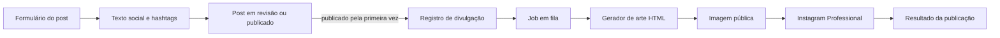

# Plano: publicação de posts no Instagram

## Objetivo geral

Permitir que o painel da Rede Akiba prepare e publique conteúdos no perfil profissional do Instagram.

O fluxo final deve:

1. coletar no painel o texto social e as hashtags;
2. salvar esses dados junto ao post antes da revisão ou publicação;
3. gerar uma arte a partir de modelos HTML dinâmicos;
4. publicar a arte e a legenda no Instagram;
5. registrar o resultado da publicação;
6. nunca impedir a publicação do post no site quando a Meta estiver indisponível.

O trabalho está dividido em capítulos. Cada etapa é uma entrega pequena, testável e adequada para uma sessão isolada. Uma etapa só deve começar depois que os critérios de conclusão da anterior estiverem atendidos.

## Regras do fluxo

- Enviar um post para revisão apenas salva a proposta de divulgação; não publica nas redes sociais.
- A publicação nas redes só é enfileirada quando o post efetivamente passa para `published`.
- Um post já publicado não deve ser reenviado automaticamente ao ser apenas atualizado.
- Texto social, hashtags e arte usada devem ser preservados para auditoria.
- Chamadas à Meta devem ocorrer em fila, fora da requisição do painel.
- Tokens e segredos ficam somente no backend e são lidos por `config/services.php`.
- O sistema deve impedir duplicidade por post e versão da divulgação.
- Feed e Story devem ser tratados como posicionamentos independentes, com arte, auditoria e idempotência próprias.
- A primeira validação real deve usar contas e conteúdos de teste.

## Arquitetura-alvo



Responsabilidades previstas:

- `app/Services`: regras da divulgação, criação dos registros e decisão de quando enfileirar;
- `app/Integrations`: requisições, autenticação e respostas da Graph API;
- `app/Processing`: renderização interna de HTML para imagem;
- `app/Jobs`: execução assíncrona e tentativas controladas;
- `resources/views`: documento HTML e suas seções visuais;
- `resources/js`: modal e integração com os formulários existentes.

---

# Capítulo 1 — Backend e integração com o Instagram

**Acompanhamento do capítulo**

- [x] Executado
- **Observações:** Capítulo concluído em 24/10/2026 com publicação real homologada no Instagram, auditoria persistida, falha isolada e idempotência confirmada pela fila.

## Objetivo do capítulo

Construir a base segura e assíncrona que consiga publicar uma imagem de teste com legenda no perfil profissional do Instagram, registrar o resultado e evitar duplicidade. Neste capítulo ainda pode ser usada uma imagem pública fixa; a geração dinâmica será conectada no Capítulo 2.

**Decisão de escopo:** o Instagram é o único canal contemplado neste plano. A autenticação adotada será o Instagram Login para uma conta profissional.

## Etapa 1 — Definir o contrato de publicação

**Acompanhamento da etapa**

- [x] Executada
- **Observações:** Contratos organizados no subescopo `app/Integrations/MetaSocial`, nome adotado para distinguir claramente a integração social da empresa Meta de metadados ou metatags. O payload mantém hashtags separadas da legenda para a formatação do Instagram. Em 24/10/2026, a chave foi estendida para `meta:{post_uuid}:{publication_uuid}:instagram:{placement}`, distinguindo `feed` e `story`. Somente falhas de limite da API e indisponibilidade temporária são recuperáveis. A extensão para posicionamentos foi validada junto ao Capítulo 2.

Tarefas:

- [x] Definir a interface de publicação no Instagram.
- [x] Definir o payload comum: legenda, hashtags, imagem e URL do post.
- [x] Definir o retorno normalizado: ID externo e data de publicação.
- [x] Definir erros recuperáveis e definitivos.
- [x] Definir a chave de idempotência por post e versão.

Critério de conclusão: os contratos de entrada, saída e erro estão definidos sem depender ainda de credenciais reais.

## Etapa 2 — Criar testes de contrato da Graph API

**Acompanhamento da etapa**

- [x] Executada
- **Observações:** Fixtures locais registram os contratos de criação, consulta e publicação de container de imagem no Instagram. Também foram registrados token inválido, permissão ausente, parâmetro inválido, limite da API e indisponibilidade temporária. O classificador considera recuperáveis somente limite da API e falha temporária.

Tarefas:

- [x] Registrar fixtures mínimas das respostas esperadas da Meta.
- [x] Cobrir criação, consulta e publicação de container no Instagram.
- [x] Cobrir token inválido, permissão ausente e limite da API.
- [x] Garantir que os testes não façam chamadas externas.

Critério de conclusão: o comportamento externo necessário está representado por testes isolados, antes da implementação do cliente.

## Etapa 3 — Adicionar configuração segura no Laravel

**Acompanhamento da etapa**

- [x] Executada
- **Observações:** Variáveis adicionadas ao `.env.example`, configuração mapeada em `config/services.php` e validação criada sem incluir valores sensíveis nas mensagens de erro. O Instagram permanece desativado por padrão até a homologação.

Tarefas:

- [x] Adicionar chaves Meta ao `.env.example`, sem valores reais.
- [x] Mapear as chaves em `config/services.php`.
- [x] Configurar versão da API, ID da conta profissional, token e chave de ativação.
- [x] Validar configuração ausente com erro claro, sem exibir segredos.
- [x] Manter o Instagram desativado por padrão fora do ambiente preparado.

Configuração prevista:

```env
META_GRAPH_VERSION=
META_INSTAGRAM_USER_ID=
META_ACCESS_TOKEN=
META_INSTAGRAM_ENABLED=false
```

Critério de conclusão: o Laravel consegue ler a configuração e informar, sem chamada externa, se o Instagram está pronto.

## Etapa 4 — Criar o cliente da Graph API

**Acompanhamento da etapa**

- [x] Executada
- **Observações:** Em 23/10/2026, o cliente e os testes foram ajustados para o Instagram Login usando `graph.instagram.com`. Foram removidos do módulo os ramos, configurações, fixtures e testes específicos do Facebook. A arquitetura genérica foi preservada por meio de `Publisher`, `PublicationChannel`, resultado por canal e chave de idempotência, permitindo adicionar outros destinos depois. Validação concluída no container: 31 testes aprovados, com 116 asserções, e 23 arquivos aprovados pelo Laravel Pint. As permissões do token real foram confirmadas pela publicação homologada em 24/10/2026.

Tarefas:

- [x] Criar uma integração no subescopo `app/Integrations/MetaSocial`.
- [x] Implementar requisições autenticadas com timeout.
- [x] Adaptar a integração para Instagram Login e o endpoint oficial correspondente.
- [x] Confirmar as permissões `instagram_business_basic` e `instagram_business_content_publish` no token.
- [x] Implementar no Instagram a criação do container de mídia.
- [x] Implementar a consulta do status do container quando necessária.
- [x] Implementar a publicação do container e retornar o media ID.
- [x] Normalizar erros sem registrar token ou payload sensível.

Critério de conclusão: testes com HTTP fake cobrem sucesso, erro de autorização, resposta inválida e indisponibilidade.

## Etapa 5 — Persistir a divulgação e o resultado

**Acompanhamento da etapa**

- [x] Executada
- **Observações:** Criadas as entidades `PostSocialPublication` e `PostSocialPublicationResult`. Cada divulgação preserva legenda, hashtags, caminho ou URL da arte, data da solicitação e um UUID que identifica sua versão. O resultado do Instagram registra status, ID externo, tentativas, erro e data de publicação. A restrição única impede duplicidade da mesma versão.

Tarefas:

- [x] Criar uma entidade de divulgação ligada ao post.
- [x] Salvar legenda, hashtags, URL/caminho da arte e data de solicitação.
- [x] Criar o resultado da publicação no `instagram`.
- [x] Registrar `pending`, `processing`, `published` ou `failed`.
- [x] Salvar ID externo, tentativas, erro sanitizado e data de publicação.
- [x] Criar restrição única que impeça publicação duplicada da mesma versão no Instagram.

Critério de conclusão: testes de model e banco demonstram auditoria da publicação e bloqueio de duplicidade.

## Etapa 6 — Orquestrar publicação em fila

**Acompanhamento da etapa**

- [x] Executada
- **Observações:** Criado `PostSocialPublicationService` para preparar a versão da divulgação e despachar o job `PublishPostSocialChannel` para o Instagram. A primeira versão usava a imagem fixa de `META_TEST_IMAGE_URL`, posteriormente substituída na Etapa 7 pela arte gerada com Intervention Image. O job usa idempotência por resultado publicado, registra tentativas e aplica backoff de 1, 5 e 15 minutos somente a falhas recuperáveis. Criação já publicada, aprovação por atualização e publicação agendada convergem no mesmo ponto de `PostService`, enquanto a atualização de um post já publicado não reenfileira.

Tarefas:

- [x] Criar o service que prepara uma divulgação quando o post vira `published`.
- [x] Criar um job pequeno para isolar falhas da publicação externa.
- [x] Configurar retries e backoff apenas para erros recuperáveis.
- [x] Fazer o job usar inicialmente uma imagem pública de teste configurada.
- [x] Garantir que falha na Meta não reverta a publicação do site.
- [x] Cobrir publicação manual, aprovação e publicação agendada pelo mesmo ponto de entrada.

Critério de conclusão: ao publicar um post, o Instagram é enfileirado uma única vez e o resultado evolui independentemente da publicação do site.

## Etapa 7 — Homologar a integração real

**Acompanhamento da etapa**

- [x] Executada
- **Observações:** Homologação concluída em 24/10/2026 na conta `@redeakiba`. O token respondeu com HTTP 200 e o ID retornado correspondeu ao configurado. Foi publicada uma imagem JPEG pública da própria Akiba com legenda e hashtags identificadas como teste; o resultado ficou `published`, com ID externo salvo, uma tentativa e nenhum erro. Uma falha de autenticação foi simulada apenas em memória: o erro ficou sanitizado, o resultado ficou `failed` e o post local permaneceu inalterado. O worker processou novamente o resultado já publicado sem duplicar o envio, confirmando a idempotência. `META_INSTAGRAM_ENABLED` permaneceu desligado após a homologação.

Tarefas:

- [x] Executar a fila em ambiente de homologação.
- [x] Publicar um conteúdo identificável como teste no Instagram.
- [x] Conferir texto, hashtags, imagem e IDs salvos.
- [x] Simular uma falha do Instagram e confirmar que ela não afeta a publicação do site.
- [x] Manter as chaves de ativação desligadas em produção até o aceite.

Critério de conclusão: o backend publica com segurança no Instagram usando uma imagem fixa, sem depender ainda do painel novo.

---

# Capítulo 2 — Modelos HTML e geração das imagens

**Acompanhamento do capítulo**

- [ ] Executado
- **Observações:** Em 24/10/2026 foi decidido preparar o fluxo para Feed e Story desde o contrato, evitando retrabalho na geração das artes. O formato inicial do Feed será `1080x1350` (`4:5`) e o do Story será `1080x1920` (`9:16`). O proprietário forneceu como referência o histórico visual do Instagram da própria Akiba e aprovou a criação de um sistema visual consistente, inspirado — sem copiar literalmente uma peça — em logo no topo, identificação do quadro, cores fortes por módulo, moldura, título direto e imagem ou personagem em destaque. O mesmo documento HTML e processo de captura atenderão o Discord em uma seção horizontal `1200x630` (`1.91:1`), inspirada em card Open Graph. A locução ganhou modelos próprios de Feed e Story destinados exclusivamente às redes sociais; a notificação textual atual de locução no Discord permanece inalterada. A publicação em Story será ativada somente depois da confirmação de que `@redeakiba` é uma conta Business e da homologação específica desse posicionamento.

## Objetivo do capítulo

Criar um documento HTML dinâmico com várias `section`. Cada `section` representa um modelo visual, recebe o mesmo contrato de dados e pode ser capturada isoladamente como imagem para Instagram ou Discord.

## Regra obrigatória antes de iniciar o capítulo

Antes de executar qualquer etapa deste capítulo, é obrigatório perguntar ao proprietário do projeto como devem ser as imagens das publicações e solicitar os exemplos visuais que ele pretende enviar.

- [x] Perguntar ao proprietário como ele imagina as artes do Instagram.
- [x] Solicitar e aguardar os exemplos visuais antes de criar HTML, CSS, composição ou identidade visual.
- [x] Analisar com o proprietário quais elementos dos exemplos devem ser reproduzidos ou apenas usados como inspiração.
- [x] Confirmar formatos, proporções, hierarquia, cores, tipografia, posição da marca e variações necessárias.
- [x] Registrar as decisões nas observações deste capítulo antes de iniciar a Etapa 1.

Enquanto essas referências e decisões não forem fornecidas e confirmadas, o Capítulo 2 deve permanecer bloqueado e nenhum modelo visual deve ser implementado por suposição.

## Etapa 1 — Definir formatos e contrato de dados

**Acompanhamento da etapa**

- [x] Executada
- **Observações:** Contrato visual compartilhado definido para Instagram e Discord. Os destinos compartilham marca, tipografia, paleta e infraestrutura de captura, mas posts e locução usam grupos de dados próprios. Os identificadores estáveis serão `instagram-feed`, `instagram-live-feed`, `instagram-story`, `instagram-live-story` e `discord-post`. O processo terá nome neutro, previsto como `SocialArtworkProcess`, com contratos específicos por tipo de conteúdo.

Tarefas:

- [x] Definir o Feed do Instagram em `1080x1350` (`4:5`).
- [x] Definir o Story do Instagram em `1080x1920` (`9:16`), mantendo conteúdo essencial fora das sobreposições do aplicativo.
- [x] Definir a arte do Discord em `1200x630` (`1.91:1`).
- [x] Definir artes de locução para Feed e Story, sem alterar a locução no Discord.
- [x] Definir os campos comuns: título, módulo, categoria, capa, autor, URL, data e marca.
- [x] Definir limites de caracteres e fallbacks para dados ausentes.
- [x] Definir identificadores estáveis para cada `section`.

Contrato visual comum:

| Campo | Regra | Fallback |
|---|---|---|
| `template` | um dos cinco identificadores estáveis definidos nesta etapa | obrigatório |
| `title` | preservar o original; apresentação limitada por seção e encerrada com reticências | `Conteúdo novo na Rede Akiba` |
| `module` | `post`, `review` ou `event` | `post` |
| `category` | até 32 caracteres | nome público do módulo: `Notícia`, `Review` ou `Evento` |
| `cover` | URL ou arquivo resolvido antes da captura; corte com `object-fit: cover` | asset local neutro da Akiba |
| `author` | até 40 caracteres | `Rede Akiba` |
| `author_avatar` | URL ou arquivo resolvido antes da captura | avatar local padrão da Akiba |
| `url` | URL canônica absoluta | URL inicial da Akiba |
| `published_at` | data no fuso `America/Sao_Paulo` | data da solicitação da divulgação |
| `brand.name` | valor fixo | `Rede Akiba` |
| `brand.logo` | asset local versionado | nome textual da marca |
| `theme` | paleta determinada pelo módulo/categoria | paleta padrão da Akiba |

Contrato complementar da locução social:

| Campo | Regra | Fallback |
|---|---|---|
| `program` | nome do programa, até 72 caracteres | `Programa ao vivo` |
| `program_image` | imagem de identidade do programa | placeholder local de programa |
| `host` | nome público do locutor, até 40 caracteres | `Equipe Rede Akiba` |
| `host_avatar` | URL ou arquivo resolvido antes da captura | avatar local padrão da Akiba |
| `status` | texto curto de presença | `Ao vivo` |
| `call_to_action` | até 32 caracteres | `Sintonize agora` |
| `background` | fundo local da composição | fundo institucional da Akiba |

Limites de apresentação do título:

| Seção | Limite | Linhas máximas |
|---|---:|---:|
| `instagram-feed` | 90 caracteres | 4 |
| `instagram-live-feed` | 72 caracteres | 3 |
| `instagram-story` | 80 caracteres | 4 |
| `instagram-live-story` | 72 caracteres | 3 |
| `discord-post` | 110 caracteres | 3 |

O contrato preserva o título integral para auditoria. Os limites acima pertencem apenas à apresentação; o mapper deve abreviar em limite de palavra e adicionar reticências de forma determinística.

Áreas seguras adotadas para a composição:

| Seção | Área segura mínima |
|---|---|
| `instagram-feed` | 72 px em todos os lados |
| `instagram-live-feed` | 72 px em todos os lados |
| `instagram-story` | 80 px nas laterais e 250 px no topo e na base, evitando a interface do aplicativo |
| `instagram-live-story` | 80 px nas laterais e 250 px no topo e na base, evitando a interface do aplicativo |
| `discord-post` | 48 px em todos os lados |

Essas margens são regras internas conservadoras do template. Fundos e imagens podem sangrar até as bordas, mas logo, título, categoria e chamadas devem permanecer dentro da área segura.

No Feed e no Story, o rodapé identifica quem publicou por meio de avatar circular e nome. O domínio não é exibido no rodapé. O Discord não inclui essa assinatura dentro da imagem, pois o próprio embed já identifica o remetente.

Nas artes provisórias de locução, o locutor é o elemento principal. A composição atual usa retrato com moldura deslocada e a chamada simples `Agora` / `No ar`; não há marca d'água, equalizador, painel de sintonia ou faixa de programa. No Story, retrato e chamada ficam centralizados. Feed e Story compartilham a linguagem visual, com arranjos próprios para cada proporção.

Composição específica de `discord-post`:

- capa preenchendo todo o quadro, sem barras laterais;
- gradiente escuro na base para assegurar contraste;
- marca da Akiba no topo, em tamanho discreto;
- categoria e data como metadados secundários;
- título alinhado à esquerda e sobreposto na região inferior;
- ausência de chamada ou URL dentro da imagem, pois o embed já apresenta título, descrição e link clicável;
- leitura preservada quando o Discord reduzir a imagem dentro do embed.

Critério de conclusão: existe um contrato único de entrada relacionando cada seção social às suas dimensões, limites e fallbacks.

## Etapa 2 — Criar o documento HTML base

**Acompanhamento da etapa**

- [x] Executada
- **Observações:** Criado `resources/views/social/artwork.blade.php`, um documento Blade autocontido com dados fictícios e as seções `instagram-feed`, `instagram-live-feed`, `instagram-story`, `instagram-live-story` e `discord-post`. Cada seção declara suas dimensões em CSS e atributos de dados, impede overflow, usa a paleta e os assets locais da Akiba e sinaliza quando fontes e imagens terminaram de carregar. A estrutura recebeu uma composição-base apenas para tornar as proporções verificáveis; o refinamento e a aprovação da identidade pertencem à Etapa 3. O bloco de locução foi simplificado para seguir a mesma hierarquia direta dos posts, com “Agora” em branco e “No ar” em uma faixa laranja. O “A” decorativo e o card “Sintonize agora” foram removidos, deixando livre a área inferior. No Stories, o retrato e a chamada foram centralizados horizontalmente; o layout do feed permanece independente. A renderização e o escape dos dados foram cobertos por teste. As rotas temporárias de preview foram removidas após a validação visual; o documento permanece disponível internamente para a futura captura automatizada.

Tarefas:

- [x] Criar um único documento HTML renderizável pelo Laravel.
- [x] Adicionar uma `section` independente para cada modelo inicial.
- [x] Aplicar dimensões fixas e impedir overflow em cada seção.
- [x] Carregar fontes e assets locais de modo determinístico.
- [x] Usar dados fictícios nesta etapa, sem integrar com posts.

Estrutura conceitual:

```html
<main>
    <section data-social-template="instagram-feed">
        <!-- composição 1080x1350 -->
    </section>
    <section data-social-template="instagram-live-feed">
        <!-- composição 1080x1350 -->
    </section>
    <section data-social-template="instagram-story">
        <!-- composição 1080x1920 -->
    </section>
    <section data-social-template="instagram-live-story">
        <!-- composição 1080x1920 -->
    </section>
    <section data-social-template="discord-post">
        <!-- composição 1200x630 -->
    </section>
</main>
```

Critério de conclusão: todas as seções podem ser abertas no navegador e têm layout previsível nas dimensões definidas.

> **Aviso sobre o design:** as imagens e composições visuais atuais são provisórias e servem apenas como protótipos técnicos para validar dimensões, campos, posicionamento e geração. Elas não representam a identidade visual definitiva. O designer produzirá as artes originais, que deverão substituir ou orientar estes layouts antes da publicação em produção.

## Etapa 3 — Criar a primeira identidade visual

**Acompanhamento da etapa**

- [ ] Executada
- **Observações:** Protótipos técnicos provisórios em avaliação, sem aprovação como identidade visual final. Todos os modelos receberam uma camada comum mais otaku sem depender de personagens licenciados: retícula de mangá, selo `秋葉`, texto auxiliar em japonês e texturas locais de sakura ou leque. As linhas radiais da primeira tentativa, o marcador `Anime culture` e o canto `CUT 01` foram removidos após avaliação do proprietário. A locução mantém sua linguagem própria de transmissão, enquanto posts e Discord preservam a composição editorial. As artes originais ainda serão produzidas pelo designer e incorporadas antes do uso em produção.

Tarefas:

- [ ] Montar hierarquia de logo, categoria, título, imagem e chamada.
- [ ] Criar corte seguro da capa e fallback sem capa.
- [ ] Limitar o título a uma quantidade controlada de linhas.
- [ ] Validar contraste e leitura em miniatura.
- [ ] Aplicar o sistema visual aos posts, à locução social e ao Discord sem apenas esticar a mesma composição.
- [ ] Aprovar com o proprietário a intensidade das referências a anime e Japão antes de concluir a identidade.

Critério de conclusão: os modelos são aprovados visualmente com conteúdo curto, médio, longo e sem imagem.

## Etapa 4 — Popular as seções com dados reais

**Acompanhamento da etapa**

- [x] Executada
- **Observações:** Criado `SocialArtworkDataService` para transformar um `Post` e a locução ativa no contrato compartilhado. O mapper resolve módulo, categoria, capa, autor, avatar, URL canônica, data no fuso `America/Sao_Paulo`, programa e locutor, aplicando fallbacks locais e abreviação determinística por seção. A integração e o escape foram validados por testes. As rotas temporárias usadas para inspeção no navegador foram removidas depois da validação, deixando o preview fora do ar; a renderização voltará a ser acessada internamente pelo processo de captura.

Tarefas:

- [x] Criar os mappers que transformam `Post` e a locução ativa nos respectivos contratos visuais.
- [x] Renderizar texto com escape seguro.
- [x] Resolver URLs ou arquivos de capa e assets de marca.
- [x] Selecionar a seção pelo identificador do modelo.
- [x] Criar uma rota de preview protegida para desenvolvimento/administração (removida após a validação).

Critério de conclusão: o contrato de um post, uma review, um evento e uma locução ativa reais é montado corretamente e validado por testes, sem gerar arquivo ainda.

## Etapa 5 — Escolher e preparar o renderizador

**Acompanhamento da etapa**

- [x] Executada
- **Observações:** Intervention Image 3.11 foi escolhido para compatibilidade com a hospedagem Hostoo e já está instalado no projeto. O driver principal será GD, disponível tanto no ambiente atual quanto na lista oficial de extensões da Hostoo. Imagick poderá ser medido como alternativa, mas não será requisito. O HTML criado nas etapas anteriores permanece como protótipo visual; em produção, o PHP comporá os dados dinâmicos sobre artes-base fornecidas pelo designer. Browsershot, Playwright e Chromium foram descartados para não depender de navegador, bibliotecas nativas ou Node em tempo de execução. O spike criou `SocialArtworkProcess` e gerou com sucesso JPEGs de Feed (`1080x1350`) e Story (`1080x1920`), além de validar saída WebP, capa, logo, avatar, fonte TTF, metadados, título com quebra controlada e rejeição de formatos desconhecidos. No ambiente Docker, o teste completo dos dois JPEGs levou aproximadamente `0,81 s` e o teste de WebP aproximadamente `0,46 s`; os arquivos JPEG ficaram limitados por teste a menos de `2 MB`. A medição definitiva de pico de memória foi transferida para a homologação na Hostoo, conforme decisão do proprietário.

Tarefas:

- [x] Escolher Intervention Image como renderizador compatível com o ambiente de produção.
- [x] Definir GD como driver principal e Imagick apenas como alternativa opcional.
- [x] Fazer um spike com uma arte-base provisória em `1080x1350` e `1080x1920`.
- [x] Validar carregamento de fontes TTF, capa, avatar e assets locais.
- [x] Fixar JPEG progressivo com qualidade inicial `88` e WebP opcional com qualidade configurável.
- [x] Medir o tempo de geração local; a medição definitiva de pico de memória foi transferida para a homologação na Hostoo.
- [x] Documentar configuração inicial de produção: extensões `gd`, `fileinfo` e `mbstring`, `memory_limit` de `512M` e `max_execution_time` de `120` segundos, sujeitas à medição na Hostoo.

Critério de conclusão: uma composição provisória é gerada localmente pelo PHP com dimensões exatas, texto e imagens corretos e resultado repetível. O consumo definitivo será homologado na hospedagem de produção, onde os limites reais se aplicam.

> O spike deve usar a dependência Intervention Image já existente. Não instalar Chromium, Puppeteer ou Playwright e não alterar os containers sem necessidade comprovada.

## Etapa 6 — Implementar o processo de geração

**Acompanhamento da etapa**

- [x] Executada
- **Observações:** `SocialArtworkProcess` consolidado como processo compartilhado em Intervention Image/GD. Ele renderiza `instagram-feed`, `instagram-live-feed`, `instagram-story`, `instagram-live-story` e `discord-post` em JPEG progressivo ou WebP, usando as dimensões fixas do contrato. `generate()` persiste diretamente no disco público em `social-artworks/{post}/{divulgacao}/`, cria um nome imutável com UUID e retorna `SocialArtworkResult` com modelo, caminho, URL absoluta, MIME type, largura, altura e tamanho. O processo valida qualidade, MIME, dimensões, limite de `8 MB`, existência de assets e segmentos de caminho. Chamadas repetidas criam novas versões sem sobrescrever arquivos anteriores. As composições continuam provisórias até a entrega das artes-base pelo designer.

Tarefas:

- [x] Criar um processo reutilizável em `app/Processing`.
- [x] Receber o identificador do modelo, os dados e o formato de saída.
- [x] Selecionar a arte-base e compor capa, avatar, textos e elementos dinâmicos.
- [x] Salvar o arquivo em caminho versionado por post e divulgação.
- [x] Validar MIME type, dimensões e tamanho final.
- [x] Retornar caminho e URL pública sem expor arquivos temporários.

Critério de conclusão: cada modelo gera seu próprio arquivo e uma nova versão não sobrescreve silenciosamente a arte já publicada.

## Etapa 7 — Conectar as artes aos fluxos do Instagram e Discord

**Acompanhamento da etapa**

- [x] Executada
- **Observações:** O fluxo deixou de depender de `META_TEST_IMAGE_URL`. `PostSocialPublicationService` gera e preserva uma arte por resultado/posicionamento, grava sua URL pública na auditoria e despacha os mesmos jobs idempotentes. Feed e Story possuem chaves independentes (`META_INSTAGRAM_FEED_ENABLED` e `META_INSTAGRAM_STORY_ENABLED`); Story permanece desligado por padrão até a confirmação da conta Business e homologação. O job envia `media_type=STORIES` sem legenda para Story e reutiliza a URL armazenada em todas as tentativas. O Discord gera `discord-post` pelo mesmo processo e o anexa sem reprocessar a capa; se essa arte não puder ser lida, mantém os fallbacks anteriores. A locução do Discord continua como embed textual. Artefatos associados à divulgação não são limpos; somente arquivos gerados antes de uma falha de persistência são removidos.

Tarefas:

- [x] Substituir a imagem fixa do Capítulo 1 pela imagem gerada via Intervention Image.
- [x] Gerar separadamente os formatos habilitados para Feed e Story.
- [x] Publicar Story com `media_type=STORIES`, sem depender da legenda do Feed.
- [x] Manter ativação independente por posicionamento e Story desligado até confirmar que a conta é Business.
- [x] Fazer o Discord anexar `discord-post` em vez de reprocessar diretamente a capa original.
- [x] Manter o embed textual atual da locução no Discord sem alterações.
- [x] Manter `PostSocialImageController` como fallback temporário para publicações sem arte gerada.
- [x] Garantir URL pública válida durante o consumo pela Meta, especialmente no Instagram.
- [x] Reutilizar a mesma arte numa tentativa repetida da mesma divulgação.
- [x] Definir limpeza apenas para temporários; preservar o artefato associado à auditoria.

Critério de conclusão: Instagram e Discord consomem artefatos do mesmo processo PHP; o Feed é publicado com a arte gerada e o Story pode ser habilitado independentemente após homologação.

## Etapa 8 — Testar casos visuais e falhas

**Acompanhamento da etapa**

- [x] Executada
- **Observações:** A suíte cobre os formatos de feed, stories e Discord, títulos extremos, caracteres especiais, emojis, fallbacks de imagens, fonte indisponível e os módulos post, review e evento. Falhas do Intervention/GD são registradas, preservam o post publicado e mantêm a política de nova tentativa da fila. Os snapshots visuais definitivos ficam adiados até a entrega das artes finais pelo design, pois os layouts atuais são provisórios.

Tarefas:

- [x] Testar títulos extremos, caracteres especiais e emojis.
- [x] Testar post sem capa, asset indisponível e fonte indisponível.
- [x] Testar post, review e evento.
- [x] Testar falha do Intervention/GD e nova tentativa do job.
- [x] Criar testes de contrato; snapshots visuais essenciais serão adicionados após a aprovação das artes finais.

Critério de conclusão: falhas de renderização ficam registradas e não afetam a publicação do post no site.

---

# Capítulo 3 — Modal e fluxo do painel administrativo

> **Decisão da primeira versão:** a publicação automática será feita somente no Feed do Instagram. Stories ficam fora do lançamento inicial; o suporte técnico permanece preparado para uma etapa futura, mas não aparece no preview, na configuração nem no enfileiramento ativo.

> **Preview oficial:** o HTML em `resources/views/social/artwork.blade.php` não é mais referência de aprovação. A referência visual passa a ser exclusivamente o JPEG produzido por `SocialArtworkProcess`, o mesmo artefato enviado às integrações.

**Acompanhamento do capítulo**

- [x] Executado
- **Observações:** Fluxo social integrado a matéria, review, evento e início de locução. As etapas funcionais, de validação e acessibilidade foram concluídas; os modelos visuais permanecem provisórios até a entrega definitiva do design.

## Objetivo do capítulo

Atualizar os formulários de posts para coletar texto social e hashtags no momento da ação. O mesmo modal será aberto por `Enviar para avaliação` ou `Publicar`, de acordo com as permissões do usuário.

## Regra de permissão

| Situação do usuário | Ação exibida | Efeito ao confirmar o modal |
|---|---|---|
| Pode editar e enviar para avaliação, mas não publicar | `Enviar para avaliação` | salva os dados sociais e muda para `revision` |
| Pode publicar diretamente | `Publicar` | salva os dados sociais e muda para `published` |
| Pode aprovar um post em avaliação | `Aprovar` | permite revisar os dados sociais e muda para `published` |
| Está apenas salvando rascunho | `Salvar como rascunho` | salva diretamente, mantendo texto social e hashtags opcionais |

O backend continua sendo a fonte de verdade para autorização. Esconder ou mostrar botões no Svelte não substitui Policy/Request validation.

## Etapa 1 — Fechar o contrato do formulário

**Acompanhamento da etapa**

- [x] Executada
- **Observações:** Foi adotada a coluna JSON anulável `posts.social`, com cast para array no model. O contrato compartilhado usa `social.text`, `social.hashtags` e `social.channels.instagram`, permitindo acrescentar outras redes futuramente sem alterar a tabela. O objeto inteiro pode ser `null` em rascunhos.

### Contrato do payload social

```json
{
  "social": {
    "text": "Texto que acompanha a publicação nas redes sociais.",
    "hashtags": ["anime", "redeakiba"],
    "channels": {
      "instagram": true
    }
  }
}
```

Regras acordadas:

- `social` é opcional e pode ser `null` enquanto o post estiver em `draft`.
- `social.text` é obrigatório ao enviar para `revision` ou `published`, deve ser texto simples e aceita no máximo 1.800 caracteres.
- `social.hashtags` é uma lista opcional com no máximo 5 itens. Cada item aceita até 50 caracteres Unicode entre letras, números e `_`.
- No modal, cada hashtag deve começar com `#` e pode ser separada por espaço ou vírgula. O backend salva os itens sem `#`, em minúsculas e sem duplicatas.
- `social.channels.instagram` permanece no contrato para extensibilidade, mas deve ser sempre `true`: a divulgação no Instagram é obrigatória nesse fluxo e não possui confirmação separada no modal.
- A legenda enviada ao Instagram será formada por `social.text`, uma linha em branco e as hashtags prefixadas com `#`. O limite editorial de 1.800 caracteres reserva espaço para as hashtags dentro da legenda.
- Salvar um `draft` nunca cria publicação externa. Enviar para `revision` apenas persiste a proposta social. A fila externa só é criada na transição efetiva para `published` e apenas para canais habilitados.

Erros de validação serão associados às chaves exatas `social`, `social.text`, `social.hashtags`, `social.hashtags.N` e `social.channels.instagram`. As mensagens devem informar, respectivamente, formato inválido, texto obrigatório ou extenso, quantidade excessiva, hashtag inválida e opção de canal inválida.

Capacidades expostas ao formulário:

| Capacidade | Origem no backend | Uso no formulário |
|---|---|---|
| `canSubmitForReview` | usuário autorizado a criar/atualizar o post | mostrar `Enviar para avaliação` |
| `canPublish` | permissão `post.publish` | mostrar `Publicar` |
| `canApprove` | Policy `approve`, permissão `post.approve`, com post em `revision` | mostrar `Aprovar` |

O Laravel validará novamente a transição solicitada; essas capacidades servem somente para apresentação da interface.

Tarefas:

- [x] Definir os campos de texto e hashtags dentro de `posts.social`.
- [x] Definir limites, obrigatoriedade e normalização das hashtags.
- [x] Definir a publicação no Instagram como obrigatória, sem confirmação separada no modal.
- [x] Definir os erros de validação retornados pelo Laravel.
- [x] Expor ao formulário apenas as capacidades necessárias: enviar para revisão, publicar e aprovar.

Critério de conclusão: payload e regras de autorização estão documentados e iguais no frontend e backend.

## Etapa 2 — Persistir o rascunho social

**Acompanhamento da etapa**

- [x] Executada
- **Observações:** `StorePostRequest` e `UpdatePostRequest` compartilham a normalização e as regras de `social`. O backend persiste o JSON, devolve os dados na edição privada e expõe apenas `submitForReview`, `publish` e `approve` como capacidades do painel. Publicação direta exige `post.publish`; a transição de `revision` para `published` exige `post.publish` ou `post.approve`. A proposta social alimenta a legenda e as hashtags auditadas, e o canal Instagram é obrigatório nesse fluxo. Rascunhos aceitam `social = null` e o envio para avaliação nunca enfileira uma publicação externa.

Tarefas:

- [x] Adicionar a persistência dos campos sociais no backend.
- [x] Validar os campos em Form Requests.
- [x] Autorizar cada transição de status no servidor.
- [x] Retornar os valores existentes ao editar um post.
- [x] Garantir que enviar para revisão não crie publicação externa.

Critério de conclusão: testes de request cobrem usuário sem permissão, envio para revisão, publicação e edição dos dados.

## Etapa 3 — Criar o modal reutilizável

**Acompanhamento da etapa**

- [x] Executada
- **Observações:** Foi criado um único `SocialPostModal.svelte`, reutilizado por matéria, review e evento. Ele trabalha sobre uma cópia dos dados, preenche valores já persistidos, exibe contador de 1.800 caracteres e 5 hashtags e apresenta os erros retornados pelo Laravel. `Publicar` abre o modal para concluir a publicação e `Enviar para avaliação` abre o mesmo modal para concluir o envio; usuários com as duas possibilidades continuam vendo ambas as ações. Rascunhos são salvos diretamente. O título identifica diretamente a etapa final, sem card introdutório, botão de cancelamento ou confirmação separada do Instagram; fechar o modal cancela a operação. Hashtags exigem `#` e aceitam separação por espaço ou vírgula. Confirmar adiciona o objeto `social` ao mesmo `useForm` do conteúdo. O modal permanece aberto durante o envio e só é fechado após resposta bem-sucedida.

Tarefas:

- [x] Criar um modal pequeno para texto social e hashtags.
- [x] Reutilizar componentes de campo, feedback e modal já existentes.
- [x] Preencher o modal com valores salvos ao editar.
- [x] Exibir contador e erros de validação.
- [x] Manter foco inicial e estados de loading acessíveis; o comportamento de teclado segue o componente `Modal` compartilhado e será auditado na etapa de acessibilidade.

Critério de conclusão: o modal funciona isoladamente nos três formulários atuais: post, review e evento.

## Etapa 4 — Interceptar “Enviar para avaliação”

**Acompanhamento da etapa**

- [x] Executada
- **Observações:** Os formulários de matéria, review e evento interceptam `revision` antes de qualquer requisição e abrem o mesmo `SocialPostModal`. O modal trabalha sobre uma cópia dos dados sociais, portanto fechá-lo não altera o status nem descarta o conteúdo editorial já preenchido. A confirmação transfere texto e hashtags ao `useForm` original e realiza um único envio. Foi adicionada uma trava local `submissionPending`, combinada ao estado `processing` do Inertia, para impedir confirmações e submits duplicados até `onFinish`; erros mantêm o modal aberto e preservam todo o formulário. Os quatro componentes envolvidos foram compilados isoladamente com sucesso. Os testes PHP não foram repetidos nesta sessão porque os containers estavam parados e o PHP local não possui as extensões do PHPUnit.

Tarefas:

- [x] Abrir o modal antes do submit da ação `revision`.
- [x] Preservar todos os dados já preenchidos no formulário principal.
- [x] Ao confirmar, anexar texto e hashtags ao mesmo envio.
- [x] Ao cancelar, manter o usuário no formulário sem mudar o status.
- [x] Impedir duplo envio.

Critério de conclusão: um usuário sem `post.publish`, mas autorizado a enviar para avaliação, conclui o fluxo uma única vez pelo modal.

## Etapa 5 — Interceptar “Publicar” e “Aprovar”

**Acompanhamento da etapa**

- [x] Executada
- **Observações:** As ações `Publicar` e `Aprovar` passam pelo mesmo `SocialPostModal` usado na revisão. O modal recebe os dados sociais persistidos, permite ajustar texto e hashtags e exibe a ação atual no cabeçalho e no botão. A confirmação devolve o payload ao formulário original e só então inicia o envio. `StorePostRequest` exige `post.publish` para publicação direta; `UpdatePostRequest` aceita `post.publish` ou `post.approve` quando um conteúdo em revisão é aprovado. `PostService` prepara Discord e Instagram somente depois da transação que efetiva a primeira publicação, sem repostar automaticamente uma atualização já publicada. A trava `submissionPending` também foi conectada aos botões externos para impedir segundo clique antes e durante o processamento. Os cinco componentes do fluxo compilaram isoladamente e os arquivos PHP envolvidos passaram na verificação de sintaxe; os testes de integração não foram repetidos porque os containers permanecem parados.

Tarefas:

- [x] Abrir o modal antes do submit da ação `published`.
- [x] Permitir ao publicador ajustar o texto e as hashtags.
- [x] Usar o mesmo componente e payload da etapa anterior.
- [x] Manter a ação explícita no título e no botão de confirmação do modal.
- [x] Só fechar após resposta bem-sucedida.

Critério de conclusão: publicação direta e aprovação usam o mesmo contrato, respeitam as permissões e enfileiram a divulgação somente após sucesso do backend.

## Etapa 6 — Integrar com os formulários existentes

**Acompanhamento da etapa**

- [x] Executada
- **Observações:** `PostForm.svelte`, `ReviewForm.svelte` e `EventForm.svelte` usam o mesmo `SocialPostModal.svelte` e agora delegam abertura, confirmação, trava contra duplicidade, envio, fechamento e reset ao controlador compartilhado `socialPostSubmission.js`. Cada formulário conserva somente sua transformação específica de payload: status direto para matéria, status dentro de `review` para review e normalização da tag `event` para evento. O controlador foi validado isoladamente para confirmar payload, impedir segundo envio enquanto pendente, fechar após sucesso e liberar o estado em `onFinish`; os quatro componentes Svelte compilaram corretamente.

Tarefas:

- [x] Integrar o modal em `PostForm.svelte`.
- [x] Integrar o modal em `ReviewForm.svelte`.
- [x] Integrar o modal em `EventForm.svelte`.
- [x] Manter `PostActions.svelte` responsável apenas pelas ações e eventos necessários.
- [x] Evitar duplicar estado e handlers entre os três formulários.

Critério de conclusão: os três módulos têm comportamento equivalente sem criar três implementações do modal.

## Etapa 7 — Aplicar interface e acessibilidade

**Acompanhamento da etapa**

- [x] Executada
- **Observações:** Os fluxos usam o modal básico do painel, sem identidade visual própria, badges, ícones ou blocos decorativos. Os modais reutilizam `Modal`, `Button`, `FormField`, `TextInput` e `TextArea`, com responsividade e rolagem já fornecidas pelos componentes. A revisão adicionou foco inicial no campo de texto, restauração do foco ao fechar, fechamento por `Esc`, contenção da navegação por `Tab`, nomes acessíveis para os diálogos e associação das instruções de hashtags aos respectivos campos. Seis componentes compilaram sem warnings e 14 testes funcionais passaram com 77 assertions.

Tarefas:

- [x] Usar `orange-citric` nas ações clicáveis e seus estados.
- [x] Usar ícones `w-6` quando acompanharem texto.
- [x] Aplicar os padrões de foco, hover, loading e `motion-reduce` do projeto.
- [x] Validar o modal em telas pequenas e conteúdo com overflow.
- [x] Confirmar navegação completa por teclado e mensagens para leitores de tela.

Critério de conclusão: o modal segue os padrões visuais do painel e permanece utilizável em mobile e teclado.

## Etapa 8 — Validar o fluxo completo

**Acompanhamento da etapa**

- [x] Executada
- **Observações:** A suíte funcional foi executada em SQLite na memória para não tocar no MySQL do ambiente. Foram aprovados 18 testes com 104 assertions cobrindo rascunho, envio para avaliação, permissões de publicação e aprovação, normalização e validação social, persistência, Feed e Story independentes, criação de artefatos, fila, idempotência, falhas definitivas, retentativas e ausência de repost ao atualizar conteúdo já publicado. O controlador compartilhado do frontend também foi validado isoladamente para cancelamento sem mutação e bloqueio de confirmação duplicada, e os cinco componentes Svelte do fluxo compilaram corretamente. Para viabilizar a suíte isolada, migrations antigas com SQL exclusivo do MySQL passaram a detectar o driver e os índices pelo Schema Builder. A chamada real à Meta continua dependendo da credencial e do ambiente de homologação/produção; nesta etapa o contrato externo permaneceu isolado por fakes.

Tarefas:

- [x] Testar autor que apenas envia para avaliação.
- [x] Testar usuário que publica diretamente.
- [x] Testar aprovador alterando a proposta social.
- [x] Testar cancelamento, validação e duplo clique.
- [x] Confirmar que atualizar um post já publicado não reposta automaticamente.
- [x] Confirmar o registro e os estados da publicação no Instagram.

Critério de conclusão: o caminho painel → aprovação/publicação → arte → fila → Meta funciona de ponta a ponta.

---

# Ordem recomendada de execução

1. Preparar os ativos e uma credencial segura de homologação na Meta.
2. Concluir o Capítulo 1 usando uma imagem pública fixa.
3. Concluir o Capítulo 2 e trocar a imagem fixa pelas artes geradas.
4. Concluir o Capítulo 3 e liberar a coleta editorial no painel.
5. Validar a credencial e a publicação no ambiente de homologação.
6. Ativar o Instagram em produção.

## Divulgação ao iniciar um programa

O início de uma locução também usa o gerador compartilhado de artes sociais, com modelos próprios para feed e stories. Nesse fluxo, a divulgação no Instagram e o aviso no Discord são obrigatórios. Antes de iniciar o programa, o locutor deve preencher uma mensagem e informar de 1 a 5 hashtags, todas iniciadas por `#`.

A mensagem e as hashtags são dados transitórios: seguem diretamente para os jobs de publicação e não são persistidas no programa nem na entrada `onair`. As imagens geradas também são temporárias e devem ser removidas depois da publicação, de uma falha definitiva ou do esgotamento das tentativas.

# Decisões que precisam ser tomadas durante o plano

- Qual versão da Graph API estará ativa quando a implementação começar?
- Qual conta profissional do Instagram será usada na homologação?
- A publicação no Instagram será sempre executada neste fluxo; não há opção para desmarcá-la no modal.
- O texto é obrigatório para revisão e publicação; hashtags são opcionais, mas cada item informado deve começar com `#`.
- Qual é o limite editorial de texto adotado pelo produto?
- Browsershot ou Playwright será usado para HTML → imagem?
- Qual seção será usada por padrão no Instagram?
- Uma alteração posterior deverá criar nova versão manual de divulgação ou nunca repostar?

# Fora do escopo inicial

- Publicação em perfis pessoais do Instagram.
- Stories, Reels, vídeos e carrosséis.
- Agendamento nativo dentro da Meta.
- Métricas, comentários e moderação das redes.
- Renovação automática complexa de credenciais antes da validação do fluxo básico.
- Repost automático ao editar um conteúdo já publicado.

# Referências oficiais para validar durante a implementação

- Instagram API: `https://developers.facebook.com/docs/instagram-platform/`
- Publicação de conteúdo no Instagram: `https://developers.facebook.com/docs/instagram-platform/content-publishing/`

Essas referências devem ser consultadas novamente em cada etapa que envolva tokens, permissões, versão ou formato de mídia.
